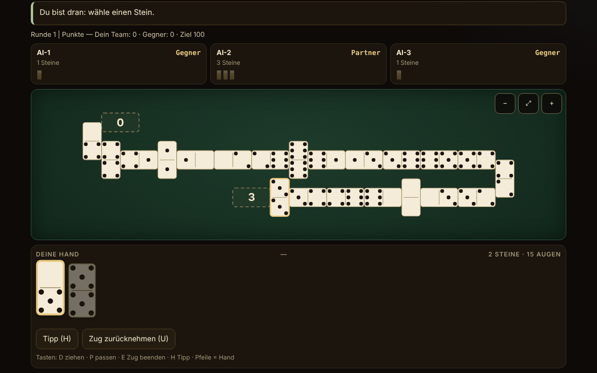

# Domino fără frontiere

[English](README.md) · [Română](README.ro.md) · [Français](README.fr.md) · [Italiano](README.it.md) · [Español](README.es.md) · [Português](README.pt.md) · **Deutsch** · [Magyar](README.hu.md)

**Version:** 2.0.1 · **Zuletzt aktualisiert:** 2026-10-27

Oberflächensprachen: **Română, English, Français, Italiano, Español, Português (PT), Deutsch, Magyar**

Domino-Atlas und Spiel gegen eine lokale KI: 10 spielbare Varianten (2–4 Spieler, Teams 2 gegen 2, wo die Regel es verlangt) und 5 nur dokumentierte Einträge. Eine einzige HTML-Datei, offline, ohne Abhängigkeiten.

**Online-App:** https://chiuta.github.io/Domino-fara-frontiere/

## Was es ist

Ein Atlas des Dominospiels (Herkunft, Regeln, Näherungen) und, für die implementierten Varianten, ein Spieltisch, an dem du (Platz 0) gegen 1–3 KI-Spieler spielst. Die Regel-Engine ist in derselben Datei von der Oberfläche getrennt, damit sie in Node getestet werden kann. Die Oberfläche und die Atlastexte liegen in 8 Sprachen vor (siehe „Sprachen“).

## Funktionen

Nur das, was im Code und in den Tests verifiziert ist:

- 10 spielbare Varianten, eine parametrisierte Engine für die „Linien“-Spiele (Block, Draw, All Fives, Muggins, Sniff, Fives and Threes, Matador, lateinisches Domino) und eine eigene Engine für Mexican Train.
- Sets mit Doppel-6 (28 Steine), Doppel-9 (55; nur bei Matador) und Doppel-12 (91; Mexican Train und Matador). Die Invariante 28/55/91 wird in den Tests bei jedem Zug geprüft.
- Große SVG-Steine mit gezeichneten Augen; jeder Stein in der Hand hat ein `aria-label` der Form „5–3“. Option „Ziffern“ statt Augen.
- Schlangentisch: Die Linie knickt am Rand mit einem senkrecht gelegten Stein ab und ändert ihre Richtung; null Steine außerhalb des Bildschirms (geprüft an 32.277 Schnappschüssen bei Breiten von 8–26 Spalten, ohne Überlappungen und ohne Überschreiten der Breite); Scrollen und Zoom (−, anpassen, +), auch bei 390 px.
- Spinner mit vier Armen (All Fives, Sniff); persönliche Züge, mexikanischer Zug, Markierungen und offene Doppel (Mexican Train).
- Erster Spieler: das höchste Doppel in den Händen (oder 6-6 beim lateinischen Domino); Ziehen aus dem Stapel, wo die Regel es erlaubt; Blockade (niemand kann mehr spielen): Es gewinnt, wer die wenigsten Restpunkte hat, nach der Wertungsregel jeder Variante (im Blatt der Variante beschrieben).
- KI in drei wirklich unterschiedlichen Stufen (siehe „Grenzen“): 1 zufällig/gierig, 2 Heuristiken, 3 zählt die gespielten Steine und schließt aus Passen, was ein Gegner nicht hat. Die KI arbeitet nur mit der öffentlichen Sicht + der eigenen Hand.
- Hinweis (H), ausdrücklicher Modus „KI-Hände zeigen“ nur zum Lernen, optionaler Seed für reproduzierbare Partien, lokale Statistiken, helles/dunkles Design (beim ersten Öffnen wird die Systemeinstellung befolgt), 3 Textgrößen, Automatikspiel des einzigen Zuges (Ziehen/Passen).
- „Zug rückgängig“ (Schaltfläche oder Taste U): kehrt zum Zustand vor deinem letzten Zug zurück (bis zu 40 Schritte, einschließlich der zwischenzeitlichen KI-Züge; der Zustand wird geklont, nicht neu berechnet). Eine Partie, in der du Rückgängig benutzt hast, geht nicht in die Statistik ein.
- Zufall: `crypto.getRandomValues` mit Rejection Sampling; mit Seed mulberry32 (dieselbe Stichprobenziehung). Fisher–Yates-Mischen.
- Barrierefreiheit: vollständiges Spiel per Tastatur, `aria-live` auf dem Status, sichtbarer Fokus, Touch-Ziele ≥ 44 px (gemessen bei 390 px; Ausnahme: die Schaltflächen in der Spendenfußzeile, ~29 px), Tastaturfokus nach jedem Zug erhalten, Kontrast ≥ 4,5:1 (gemessen an den Farbpaaren beider Designs), `prefers-reduced-motion`, kein horizontales Scrollen bei 390 px, `<noscript>`, dynamisches `lang`.

## Varianten

| Variante | Spielbar? | ⚠ Näherungen (kurz; der vollständige Text steht im Blatt in der App) |
|---|---|---|
| Block (ohne Ziehen) | ja | – |
| Draw (mit Ziehen aus dem Stapel) | ja | Hände 7/7/6 (2/3/4 Spieler), Reserve von 2 Steinen (Pagat); ⚠ freiwilliges Ziehen ist nicht erlaubt (man zieht nur, wenn man nicht spielen kann) |
| All Fives (mit Spinner) | ja | ⚠ die Arme 3–4 öffnen sich erst, nachdem der Spinner beide Seiten belegt hat (amerikanischer Brauch); Rundung auf 5 auf die Gesamtsumme, nicht Stein für Stein; bei 3 Spielern teilt ein Gleichstand die abgerundete Hälfte |
| Muggins (All Fives ohne Spinner) | ja | ⚠ die Quelle ist widersprüchlich; gewählt wurde „wer ausgeht, kassiert“; ohne Teams |
| Sniff | ja | amerikanische Variante (querliegender Sniff = Spinner); die seitlichen Enden des Spinners zählen, solange sie frei sind (das Beispiel 8/14/15 von Pagat geprüft); ⚠ Rundung und Blockade von der Quelle nicht präzisiert; ohne Teams |
| Fives and Threes | ja | ⚠ ohne Teams („chip out“ auf Partner); eröffnet mit dem höchsten Doppel statt Losziehen; KI: Die Stufen unterscheiden sich nicht messbar |
| Matador (Summe 7) | ja | ⚠ die Matadore für Doppel-9/12 sind extrapoliert; die Quelle beschreibt nur 4 Spieler (2–3 ist eine Erweiterung); Hand von 7 Steinen auch bei Doppel-9/12; gewählte Passregel: „man zieht, bis man spielen kann oder 2 Steine übrig sind“ |
| Lateinisches Domino in 2v2-Teams, venezolanischer Stil, Ziel 100 | ja | ⚠ die mexikanische Version (andere Blockade-/Startregeln) ist nicht implementiert; nur die auf Pagat beschriebene Variante; Cuban/Dominican werden nicht nachgebildet; ohne „Hand neu machen“, ohne Boni capicúa/chuchazo/dominao |
| Lateinisches Domino 200 | ja | ⚠ weder reines FID noch reines „Doscientos“ (Hybrid); nach einer Blockade beginnt der Spieler mit den wenigsten Punkten aus dem Siegerteam; eröffnet mit 6-6 (die FID wählt durch Ziehen von Steinen); ohne „Quinientos“ und „Chiva“ |
| Mexican Train (Doppel-12, persönliche Züge) | ja | ⚠ 2–4 Spieler (die Quelle erlaubt 10); 1, 3 oder 13 Runden; das Doppel-Blank bei 50 nur als Option; KI: Die Stufen 2 und 3 sind gleich stark |
| Chicken Foot | nur Atlas | nicht implementiert (Baumanordnung) |
| Bergen / Double Bergen | nur Atlas | die Bergen-Wertung ist nicht implementiert |
| Five Up | nur Atlas | die vollständigen Regeln wurden nicht geprüft |
| All Threes | nur Atlas | nicht separat implementiert |
| Regionale lateinische Varianten (Quinientos, Milo, Sudan) | nur Atlas | – |

Nicht enthalten sind „Farb-Dominos“ (mehrdeutiger Begriff) und Sebastopol (die Quellseite konnte nicht eingesehen werden; über sie wird nichts behauptet).

**Die gewählte lateinische Variante.** Lateinisches Teamdomino wird in mehreren regionalen Versionen gespielt. Implementiert wurden die auf Pagat beschriebene venezolanische/mexikanische Version (Ziel 100, am Ende erhält der Gewinner die Punkte der übrigen Steine der Gegner) und die 200er-Version (FID/„Doscientos“, alle übrigen Punkte werden addiert, der Gewinner der Hand eröffnet die nächste). Die Begriffe: „pase“ = auf einen Zug verzichten; „pase mutual“ = tranque, also die Blockade, in der niemand mehr spielen kann (es gewinnt das Team mit weniger Punkten, ein Gleichstand gibt keine Punkte); „capot“ = Sieg mit den Gegnern bei null (hier gewählte Definition, keine Verbandsnorm).

## Bedienungsanleitung

1. Wähle im **Atlas** eine Variante und drücke „Spielen“. „Regeln“ zeigt die Herkunft, die Regeln und die Näherungen.
2. Wähle im Einstellungsfenster die Spielerzahl, die Teams (bei 4), die KI-Stufe, eventuell einen Seed; drücke „Spielen“.
3. Wenn du am Zug bist, sind die spielbaren Steine angehoben und hervorgehoben. Drücke einen Stein; hat er nur ein Ziel, wird er sofort gespielt, andernfalls wählst du das Ziel mit den Schaltflächen unter der Hand oder indem du ein markiertes Ende auf dem Tisch drückst.
4. Hast du keinen Zug: „Ziehen“ (D) oder „Passen“ (P). Bei aktiviertem „Auto“ wird der einzige Zug nach einer Sekunde automatisch gemacht.
5. Mexican Train: Dein erster Zug kann eine Kette von Steinen auf deinem Zug sein, dann „Zug beenden“ (E). Ein Doppel verlangt einen weiteren Stein; ein offenes Doppel muss bedient werden. Wenn du passt, setzt du deine Markierung auf den Zug.
6. Tastatur: Tab bis zur Hand, Pfeile zwischen den Steinen, Enter zum Spielen; D, P, E, H (Hinweis), U (Zug rückgängig). Esc schließt die Fenster.
7. Die Schaltflächen in der Ecke: Sprache, Design, Textgröße, Ziffern, Auto, Statistiken, Über. Zoom auf dem Tisch: −, ⤢, +.

## Sprachen

Die Oberflächenelemente (Schaltflächen, Meldungen, Protokoll, Ergebnisse) sind auf Rumänisch, Englisch, Französisch, Italienisch, Spanisch, Portugiesisch, Deutsch und Ungarisch, mit Umschalter und automatischer Erkennung. **Die langen Atlastexte (Herkunft, Beschreibung, Regeln, Näherungen aller 15 Karten) sind in alle 8 Sprachen übersetzt, und die Suche umfasst Name und Beschreibung in der aktuellen Sprache. Unverändert bleiben: die Quellenliste (Zitate/URLs; ihre zweite Zeile bleibt auf Rumänisch) und die Begriffe des lateinischen Dominos (pase, tranque, capot), wie in der Quelle belassen. Die Übersetzungen ins Französische, Italienische, Spanische, Portugiesische, Deutsche und Ungarische sind automatisch und nicht von Muttersprachlern geprüft.** Die Parität der Übersetzungsschlüssel wird mit einem Skript geprüft (`tests/i18n-check.js`: 180 Schlüssel × 7 Sprachen, ohne Lücken, dieselben Platzhalter).

## Datenschutz und Netzwerk

Keine Telemetrie, keine Netzwerkanfragen, kein `fetch`, kein `eval`. CSP: `default-src 'none'; script-src 'sha256-…'; style-src 'unsafe-inline'; img-src data:; base-uri 'none'; form-action 'none'` (das Skript ist per Hash gebunden; `style-src 'unsafe-inline'` ist für den Inline-Stil und für den Unterstützungsblock nötig). Einstellungen und Statistiken werden in `localStorage` (Schlüssel `domino-fara-frontiere.prefs`) gehalten, auf den nur in `try/catch` zugegriffen wird; ohne ihn funktioniert die App (getestet mit blockiertem `localStorage`). `innerHTML` wird nur für SVG verwendet, das aus ganzen Zahlen und über `esc()` geleiteten Zeichenketten erzeugt wird. Die einzigen externen Links sind Buy Me a Coffee im Unterstützungsblock (`rel="noopener"`), identisch aus den anderen Repos kopiert.

## Grenzen und Warnungen

- **KI**: Sie hat keinen Zugriff auf die Hände der anderen. Stufe 1: zufällig (oder gierig nach Punkten bei den Spielen mit Wertung an den Enden). Stufe 2: Heuristiken (Punkte, Flexibilität, Doppel, Erhalt der Matadore). Stufe 3: zusätzlich zählt sie die gespielten Steine, schließt aus Passen, was ein Gegner nicht hat, und schätzt die Wahrscheinlichkeit, dass die Gegner passen. Gemessene Stärke (300 Partien, wechselnde Plätze): Stufe 3 schlägt Stufe 1 in 54–98 % der Partien (je nach Variante) und Stufe 2 in 52–76 %; Stufe 2 schlägt Stufe 1 in 48–98 %. **Ausnahmen**: Bei Fives and Threes sind die Stufen praktisch gleich (~50 %), und bei Mexican Train sind die Stufen 2 und 3 gleich stark (44 % für Stufe 3 gegen 2), beide schlagen Stufe 1 deutlich (80–85 %). Der Modus „KI-Hände zeigen“ ist ausdrücklich und nur zum Lernen; die KI schaut ohnehin nicht auf deine Hand.
- Die Regeln mancher Spiele unterscheiden sich von Region zu Region; die getroffenen Entscheidungen stehen in der ⚠-Spalte und in den Blättern in der App.
- Es ist kein Wettwerkzeug und hat für Verbände keinen offiziellen Wert.
- Die Oberfläche wurde visuell in Chromium geprüft (1280×800 und 390×844); sie wurde nicht auf Safari, Firefox oder mit echten Screenreadern getestet.
- Ein Mehrspielermodus im Netzwerk wurde nicht implementiert (und wird es nicht: Die App hat kein Netzwerk).

## Tests

Alles Folgende wurde auf der finalen `index.html` ausgeführt (die Skripte werden außerhalb des Pakets aufbewahrt):

- **KI-gegen-KI-Partien**, 500 Partien pro Konfiguration, Schritt für Schritt von einem unabhängigen Legalitätsprüfer validiert (aus den Regeln neu implementiert, ohne Code aus der Engine): Block 2/3/4, Draw 2/3/4, Matador Doppel-6/9/12 bei 2/3/4, All Fives 2/3/4 + Teams, Muggins 2/3/4, Sniff 2/3/4, Fives and Threes 2/3/4, Latein 100 und Latein 200; Mexican Train 2/3/4 × 500 Partien × 13 Runden (19.500 Runden). Ergebnis: **0 Fehlschläge** (keine Engine-Blockaden, keine illegalen Züge, Invariante 28/55/91 bei jedem Zug, Hände und Stapel identisch mit dem Prüfer, Punkte an den Enden gleich den unabhängig berechneten, Handgewinn am Ende identisch).
- **Von Hand geschriebene Szenarien**: 227 Prüfungen, 0 Fehlschläge (Wertung All Fives / Muggins / Fives and Threes an den Enden, einschließlich Doppel am Ende, Spinner und fehlendem Spinner; Mexican Train: offene Doppel auf dem eigenen Zug, auf dem eines anderen markiert/unmarkiert und auf dem mexikanischen, erster Zug, Markierungen, Blockade, Doppel-Blank bei 50, 13 Runden; KI ohne Zugriff auf die Hände).
- **Tischanordnung**: 32.277 Schnappschüsse, 12,7 Millionen Prüfungen (keine Überlappungen, kein Überschreiten der Breite, korrekte Steinanzahl), Breiten von 8 bis 26 Spalten.
- **UI** (Playwright + Chromium): je eine vollständige, über die Oberfläche gespielte Partie bei jeder Variante bei 1280 px und 390 px, 0 Konsolenfehler, 0 CSP-Verstöße, 0 externe Anfragen, kein horizontales Scrollen; Tastaturspiel; blockierter `localStorage`; automatische Spracherkennung; Touch-Ziele ≥ 44 px (außer der Fußzeile).

## Quellen

- Pagat.com: Muggins, Block, All Fives, Sniff, Fives and Threes, Matador, Bergen, Latin Partnership Dominoes, Mexican Train, Chicken Foot und die Familienseiten (fives family, train family, matador matching, Bergen scoring). Die Regeln wurden aus dem Text gelesen und implementiert; wo die Quelle widersprüchlich ist oder schweigt, ist die Entscheidung mit ⚠ markiert.
- Für die kubanische, dominikanische und die Sebastopol-Version konnte keine Quelle eingesehen werden; es wird nicht behauptet, dass sie nachgebildet sind.

## Lokale Ausführung

Öffne `index.html` in einem Browser (es wird kein Server benötigt). Zum Neuaufbau aus den Arbeitsquellen: `node build.mjs`; für Tests: `node tests/fuzz.js <index.html> 500`, `node tests/scenarios.js <index.html>`, `node tests/layout.js <index.html>`, `node tests/i18n-check.js` (die Skripte liegen im Arbeitsverzeichnis, außerhalb des veröffentlichten Pakets).

## Verlauf / Changelog

### 1.2.7 — 2026-10-23
- Die Speicherschlüssel tragen jetzt das App-Präfix (`domino-fara-frontiere.prefs`); vorhandene Daten (Einstellungen, Design und Statistik) werden beim Start automatisch migriert, alte `.fff.json`-Kopien lassen sich weiterhin importieren.
- fff-kit 1.2.0: Speicher ohne Präfix behoben

### 1.2.5 — 2026-10-22

fff-kit 1.1.4: Touch-Ziele und Mindestschriftgröße.

### 1.2.4 — 2026-10-22

fff-kit 1.1.2: PBKDF2 mit 600.000 Iterationen, Schutz vor Clickjacking.

- 1.2.3 — 2026-10-22: Feinschliff für Mobilgeräte und Barrierefreiheit: Text mit mindestens 12 px und Touch-Ziele von mindestens 24 px. sichtbarer Tastaturfokus bei jedem Steuerelement.
- 1.2.2 — 2026-10-22: **Korrektur**: der Abschnitt „Quellen“ ist jetzt in alle Sprachen übersetzt.
- 1.2.1 — 2026-10-19: alle 15 Atlaskarten (Name, Herkunft, Beschreibung, Regeln, Näherungen; rund 21.000 Zeichen) sind nach fr, it, es, pt, de, hu übersetzt; der Hinweis „Text auf Englisch“ erscheint nicht mehr; die Suche umfasst Name und Beschreibung in der aktuellen Sprache.
- 1.1.0 — 2026-10-14: Datensicherung und Datenkennzeichnung (fff-kit).

- 1.0.0 — 2026-10-12: Version und Datum der letzten Aktualisierung werden in der App angezeigt (erste nummerierte Version; im Dialog „Über“).

Runde 7:
- Eine begonnene (nach dem ersten Zug) und nicht beendete Partie verlangt nun beim Neuladen oder Schließen der Seite die Bestätigung des Browsers (`beforeunload`), damit du die Partie nicht versehentlich verlierst; nach „game over“ und vor dem ersten Zug erscheint keine Frage. Die Partie wird zwischen Besuchen nicht gespeichert. CSP-Hash neu berechnet; axe-core = 0 Verstöße bei 1280 und 360 px.
- Die Suite `tests/` und `build.mjs` aus dem Abschnitt „Lokale Ausführung“ bleiben außerhalb des veröffentlichten Repositorys (auch dort angegeben); Prüfungen: `node --check`, eine Partie über die Oberfläche, 0 Konsolen-/CSP-Fehler.

Runde 6:
- Neu: „Zug rückgängig“ (U) mit einem Stapel von 40 Zuständen; Partien mit Rückgängig sind von den Statistiken ausgeschlossen. Das Anfangsdesign folgt `prefers-color-scheme`, wenn kein anderes gespeichert ist. Das Partieprotokoll lässt sich per Tastatur scrollen (Landmark mit `tabindex`). CSP-Hash neu berechnet.
- Wenn du einen Stein gewählt hast, der an zwei Enden angelegt werden kann, erscheint nun eine sichtbare Meldung „Wähle, wo du … anlegst“ über den Zielschaltflächen (vorher gab es nur die Statusmeldung).
- Barrierefreiheit: Die Kartentitel im Atlas sind h2 (korrekte Reihenfolge unter h1), der Unterstützungsblock ist ein `complementary`-Landmark; axe-core = 0 Verstöße bei 1280 und 360 px. Der CSP-Hash des Skripts wurde neu berechnet.
- Hinweis: Die Testsuite aus der README (`tests/`) und `build.mjs` befinden sich nicht in diesem Repository; nach der Änderung wurden `node --check`, eine Partie über die Oberfläche und 0 Konsolen-/CSP-Fehler geprüft.

## Lizenz

MIT — siehe Datei `LICENSE`.

## Handelsnamen

„Mexican Train“ und andere Produktnamen können Marken ihrer Inhaber sein; die App ist nicht mit ihnen verbunden, und die Namen werden beschreibend für traditionelle Domino-Regeln verwendet.

## Autor

Alexandru-Ionuț Chiuță (Alexio).

## Zusammenfassung
Ein Domino-Atlas in einer einzigen Datei, offline, mit zehn spielbaren Varianten gegen eine lokale KI (Block, Draw, All Fives, Muggins, Sniff, Fives and Threes, Matador auf Doppel-6/9/12, zwei lateinische 2v2-Teamversionen und Mexican Train auf Doppel-12) plus fünf nur dokumentierten Einträgen (Chicken Foot, Bergen, Five Up, All Threes, regionale lateinische Versionen). Die Regel-Engine ist rein und von der Oberfläche getrennt, mit Schlangentisch, Scrollen und Zoom, vollständigem Tastaturspiel und einer Oberfläche in 8 Sprachen (auch die langen Atlastexte sind übersetzt). Die KI sieht nie verdeckte Hände (Stufe 3 zählt Steine und schließt aus Passen); die Stufen 2 und 3 sind bei Mexican Train gleich stark, und alle drei sind bei Fives and Threes etwa gleich. Geprüft mit 500 unabhängig validierten KI-gegen-KI-Partien pro Konfiguration (0 Fehlschläge), 227 von Hand geschriebenen Regelszenarien (plus 135 aus dem unabhängigen Audit) und Layout-Fuzzing. Kein Netzwerk, keine Telemetrie, strenge CSP. Jede Näherung ist in der Variantentabelle und in den Regeln der App markiert. Lizenz: MIT (siehe LICENSE). Regelquellen: Pagat.com.

## Unabhängiges Audit

Ein gesondertes adversariales Audit hat korrigiert: die Hände bei Draw, die Wertung bei Sniff, den beginnenden Spieler nach einer Blockade bei Latein 200, einen Absturz bei in localStorage beschädigten Statistiken, den Verlust des Tastaturfokus, einen Fallback für einen illegalen KI-Zug. Ausgeführt auf der finalen Version: unabhängiger Fuzz (Linie + Zug), 135 Szenarien, Test verdeckter Information für die KI, 6000 Tische, RNG, i18n, plus die Tests des Builders.
