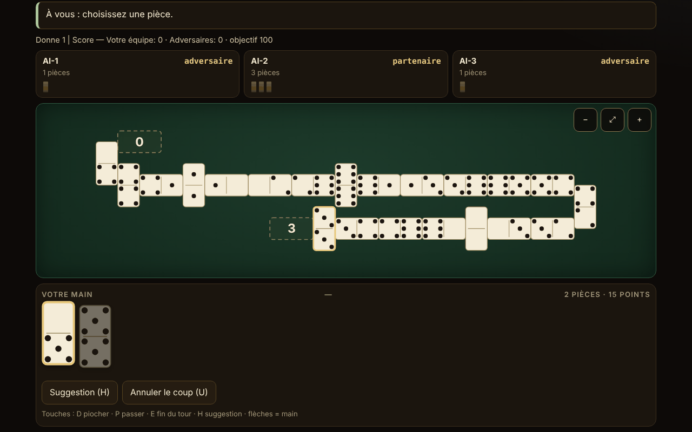

# Domino fără frontiere

[English](README.md) · [Română](README.ro.md) · **Français** · [Italiano](README.it.md) · [Español](README.es.md) · [Português](README.pt.md) · [Deutsch](README.de.md) · [Magyar](README.hu.md)

**Version :** 1.2.7 · **Dernière mise à jour :** 2026-10-23

Langues de l'interface : **Română, English, Français, Italiano, Español, Português (PT), Deutsch, Magyar**

Atlas du domino et jeu contre une IA locale : 10 variantes jouables (2 à 4 joueurs, équipes 2 contre 2 là où la règle l'exige) et 5 fiches seulement documentées. Un seul fichier HTML, hors ligne, sans dépendances.

**Application en ligne :** https://chiuta.github.io/Domino-fara-frontiere/

## Ce que c'est

Un atlas du domino (origine, règles, approximations) et, pour les variantes implémentées, une table de jeu où vous jouez (place 0) contre 1 à 3 joueurs IA. Le moteur de règles est séparé de l'interface dans le même fichier, afin de pouvoir être testé sous Node. L'interface et les textes de l'atlas sont disponibles en 8 langues (voir « Langues »).

## Fonctionnalités

Uniquement ce qui est vérifié dans le code et dans les tests :

- 10 variantes jouables, un moteur paramétré pour les jeux « en ligne » (Block, Draw, All Fives, Muggins, Sniff, Fives and Threes, Matador, domino latin) et un moteur distinct pour le Mexican Train.
- Jeux de double-6 (28 pièces), double-9 (55 ; uniquement pour le Matador) et double-12 (91 ; Mexican Train et Matador). L'invariant 28/55/91 est vérifié à chaque coup dans les tests.
- Grandes pièces SVG, avec les points dessinés ; chaque pièce de la main a un `aria-label` de la forme « 5–3 ». Option « Chiffres » à la place des points.
- Table en serpentin : la ligne se brise au bord avec une pièce posée à la verticale et change de sens ; aucune pièce hors de l'écran (vérifié sur 32 277 instantanés à des largeurs de 8 à 26 colonnes, sans chevauchements ni débordements de la largeur) ; défilement et zoom (−, ajuster, +), y compris à 390 px.
- Spinner à quatre bras (All Fives, Sniff) ; trains personnels, train mexicain, marqueurs et doubles ouverts (Mexican Train).
- Premier joueur : le plus grand double des mains (ou 6-6 au domino latin) ; pioche dans le talon là où la règle le permet ; blocage (plus personne ne peut jouer) : gagne celui qui a le moins de points restants, selon la règle de score de chaque variante (décrite dans la fiche de la variante).
- IA à trois niveaux réellement différents (voir « Limites ») : 1 aléatoire/glouton, 2 heuristiques, 3 compte les pièces jouées et déduit des passes ce qu'un adversaire n'a pas. L'IA ne travaille que sur la vue publique + sa propre main.
- Suggestion (H), mode « montrer les mains de l'IA » explicite et réservé à l'apprentissage, graine facultative pour des parties reproductibles, statistiques locales, thème clair/sombre (à la première ouverture, la préférence du système est suivie), 3 tailles de texte, jeu automatique du coup unique (pioche/passe).
- « Annuler le coup » (bouton ou touche U) : revient à l'état d'avant votre dernier coup (jusqu'à 40 pas, y compris les coups de l'IA joués entre-temps ; l'état est cloné, non recalculé). Une partie où vous avez utilisé l'annulation n'entre pas dans les statistiques.
- Aléatoire : `crypto.getRandomValues` avec échantillonnage par rejet ; avec une graine, mulberry32 (même échantillonnage). Mélange de Fisher–Yates.
- Accessibilité : jeu complet au clavier, `aria-live` sur l'état, focus visible, cibles tactiles ≥ 44 px (mesuré à 390 px ; exception : les boutons du pied de page de dons, ~29 px), focus clavier conservé après chaque coup, contraste ≥ 4,5:1 (mesuré sur les paires de couleurs des deux thèmes), `prefers-reduced-motion`, pas de défilement horizontal à 390 px, `<noscript>`, `lang` dynamique.

## Variantes

| Variante | Jouable ? | ⚠ Approximations (en bref ; le texte complet est dans la fiche de l'application) |
|---|---|---|
| Block (sans pioche) | oui | – |
| Draw (avec pioche dans le talon) | oui | Mains 7/7/6 (2/3/4 joueurs), réserve de 2 pièces (Pagat) ; ⚠ la pioche volontaire n'est pas permise (on ne pioche que lorsqu'on ne peut pas jouer) |
| All Fives (avec spinner) | oui | ⚠ les bras 3–4 ne s'ouvrent qu'une fois que le spinner a ses deux côtés couverts (usage américain) ; arrondi à 5 sur le total, et non pièce par pièce ; à 3 joueurs, l'égalité partage la moitié arrondie à l'inférieur |
| Muggins (All Fives sans spinner) | oui | ⚠ la source est incohérente ; on a choisi « celui qui sort encaisse » ; sans équipes |
| Sniff | oui | variante américaine (Sniff transversal = spinner) ; les extrémités latérales du spinner comptent tant qu'elles sont libres (l'exemple 8/14/15 de Pagat vérifié) ; ⚠ arrondi et blocage non précisés par la source ; sans équipes |
| Fives and Threes | oui | ⚠ sans équipes (« chip out » sur les partenaires) ; ouvre avec le plus grand double au lieu d'un tirage au sort ; IA : les niveaux ne diffèrent pas de façon mesurable |
| Matador (somme 7) | oui | ⚠ les matadors pour double-9/12 sont extrapolés ; la source ne décrit que 4 joueurs (2–3 est une extension) ; main de 7 pièces aussi à double-9/12 ; règle de passe choisie : « on pioche jusqu'à pouvoir jouer ou jusqu'à ce qu'il reste 2 pièces » |
| Domino latin par équipes 2v2, style vénézuélien, objectif 100 | oui | ⚠ la version mexicaine (règles de blocage/départ différentes) n'est pas implémentée ; seule la variante décrite sur Pagat ; Cuban/Dominican ne sont pas reproduites ; sans « refaire la main », sans bonus capicúa/chuchazo/dominao |
| Domino latin 200 | oui | ⚠ ni FID pur, ni « Doscientos » pur (hybride) ; après un blocage commence le joueur ayant le moins de points de l'équipe gagnante ; ouvre avec 6-6 (la FID choisit par tirage de pièces) ; sans « Quinientos » ni « Chiva » |
| Mexican Train (double-12, trains personnels) | oui | ⚠ 2–4 joueurs (la source en permet 10) ; 1, 3 ou 13 manches ; le double-blanc à 50 seulement en option ; IA : les niveaux 2 et 3 sont aussi forts |
| Chicken Foot | atlas seulement | non implémenté (disposition en arbre) |
| Bergen / Double Bergen | atlas seulement | le décompte Bergen n'est pas implémenté |
| Five Up | atlas seulement | les règles complètes n'ont pas été vérifiées |
| All Threes | atlas seulement | non implémenté séparément |
| Variantes latines régionales (Quinientos, Milo, Sudan) | atlas seulement | – |

Ne sont pas incluses les « dominos de couleur » (terme ambigu) et le Sebastopol (la page source n'a pu être consultée ; rien n'est prétendu à leur sujet).

**La variante latine retenue.** Le domino latin par équipes se joue en plusieurs versions régionales. On a implémenté la version vénézuélienne/mexicaine décrite sur Pagat (objectif 100, à la fin le vainqueur prend les points des pièces restantes des adversaires) et la version à 200 (FID/« Doscientos », on additionne tous les points restants, le vainqueur de la main ouvre la suivante). Les termes : « pase » = s'abstenir de jouer ; « pase mutual » = tranque, c'est-à-dire le blocage où plus personne ne peut jouer (l'équipe ayant le moins de points gagne, l'égalité ne donne pas de points) ; « capot » = victoire avec les adversaires à zéro (définition retenue ici, et non norme fédérale).

## Mode d'emploi

1. Dans l'**Atlas**, choisissez une variante et appuyez sur « Jouer ». « Règles » montre l'origine, les règles et les approximations.
2. Dans la fenêtre des réglages, choisissez le nombre de joueurs, les équipes (à 4), le niveau de l'IA, éventuellement une graine ; appuyez sur « Jouer ».
3. Quand c'est votre tour, les pièces jouables sont relevées et mises en évidence. Appuyez sur une pièce ; si elle n'a qu'une seule destination, elle est jouée immédiatement, sinon vous choisissez la destination avec les boutons sous la main ou en appuyant sur une extrémité marquée sur la table.
4. Si vous n'avez aucun coup : « Piocher » (D) ou « Passer » (P). Avec « Auto » activé, le coup unique est joué automatiquement après une seconde.
5. Mexican Train : votre premier tour peut être une chaîne de pièces sur votre train, puis « Terminer le tour » (E). Un double exige une pièce de plus ; un double ouvert doit être satisfait. Quand vous passez, vous posez votre marqueur sur le train.
6. Clavier : Tab jusqu'à la main, flèches entre les pièces, Entrée pour jouer ; D, P, E, H (suggestion), U (annuler le coup). Échap ferme les fenêtres.
7. Les boutons du coin : langue, thème, taille du texte, chiffres, auto, statistiques, à propos. Zoom sur la table : −, ⤢, +.

## Langues

Les éléments de l'interface (boutons, messages, journal, résultats) sont en roumain, anglais, français, italien, espagnol, portugais, allemand et hongrois, avec un sélecteur et une détection automatique. **Les longs textes de l'atlas (origine, description, règles, approximations des 15 fiches) sont traduits dans les 8 langues, et la recherche couvre le nom et la description dans la langue courante. Restent tels quels : la liste des sources (citations/URL ; sa deuxième ligne reste en roumain) et les termes du domino latin (pase, tranque, capot), conservés comme dans la source. Les traductions en français, italien, espagnol, portugais, allemand et hongrois sont automatiques, non vérifiées par des locuteurs natifs.** La parité des clés de traduction est vérifiée par un script (`tests/i18n-check.js` : 180 clés × 7 langues, sans trous, mêmes paramètres substituables).

## Confidentialité et réseau

Pas de télémétrie, pas de requêtes réseau, pas de `fetch`, pas d'`eval`. CSP : `default-src 'none'; script-src 'sha256-…'; style-src 'unsafe-inline'; img-src data:; base-uri 'none'; form-action 'none'` (le script est lié par hachage ; `style-src 'unsafe-inline'` est nécessaire pour le style en ligne et pour le bloc de soutien). Les préférences et les statistiques sont conservées dans `localStorage` (clé `domino-fara-frontiere.prefs`), accédé uniquement dans un `try/catch` ; sans lui, l'application fonctionne (testé avec `localStorage` bloqué). `innerHTML` n'est utilisé que pour du SVG généré à partir d'entiers et de chaînes passées par `esc()`. Les seuls liens externes sont Buy Me a Coffee dans le bloc de soutien (`rel="noopener"`), copié à l'identique des autres dépôts.

## Limites et avertissements

- **IA** : elle n'a pas accès aux mains des autres. Niveau 1 : aléatoire (ou glouton sur les points dans les jeux avec score aux extrémités). Niveau 2 : heuristiques (points, flexibilité, doubles, conservation des matadors). Niveau 3 : en plus, compte les pièces jouées, déduit des passes ce qu'un adversaire n'a pas et estime la probabilité que les adversaires passent. Force mesurée (300 parties, places alternées) : le niveau 3 bat le niveau 1 dans 54–98 % des parties (selon la variante) et le niveau 2 dans 52–76 % ; le niveau 2 bat le niveau 1 dans 48–98 %. **Exceptions** : à Fives and Threes, les niveaux sont pratiquement égaux (~50 %), et au Mexican Train les niveaux 2 et 3 sont aussi forts (44 % pour le niveau 3 face au 2), les deux battant nettement le niveau 1 (80–85 %). Le mode « montrer les mains de l'IA » est explicite et réservé à l'apprentissage ; l'IA ne regarde de toute façon pas votre main.
- Les règles de certains jeux diffèrent d'une région à l'autre ; les choix effectués figurent dans la colonne ⚠ et dans les fiches de l'application.
- Ce n'est pas un outil de paris et il n'a aucune valeur officielle pour les fédérations.
- L'interface a été vérifiée visuellement dans Chromium (1280×800 et 390×844) ; elle n'a pas été testée sur Safari, Firefox ni avec de vrais lecteurs d'écran.
- Le mode multijoueur en réseau n'a pas été implémenté (et ne le sera pas : l'application n'a pas de réseau).

## Tests

Tout ce qui suit a été exécuté sur le `index.html` final (les scripts sont conservés hors du paquet) :

- **Parties IA contre IA**, 500 parties par configuration, validées pas à pas par un validateur de légalité indépendant (réimplémenté à partir des règles, sans code du moteur) : Block 2/3/4, Draw 2/3/4, Matador double-6/9/12 à 2/3/4, All Fives 2/3/4 + équipes, Muggins 2/3/4, Sniff 2/3/4, Fives and Threes 2/3/4, latin 100 et latin 200 ; Mexican Train 2/3/4 × 500 parties × 13 manches (19 500 manches). Résultat : **0 échec** (pas de blocages du moteur, pas de coups illégaux, invariant 28/55/91 à chaque coup, mains et talon identiques à ceux du validateur, points aux extrémités égaux à ceux calculés indépendamment, gain de fin de main identique).
- **Scénarios écrits à la main** : 227 vérifications, 0 échec (décompte All Fives / Muggins / Fives and Threes sur les extrémités, y compris double à l'extrémité, spinner et absence de spinner ; Mexican Train : doubles ouverts sur son propre train, sur celui d'un autre marqué/non marqué et sur le mexicain, premier tour, marqueurs, blocage, double-blanc à 50, 13 manches ; IA sans accès aux mains).
- **Disposition de la table** : 32 277 instantanés, 12,7 millions de vérifications (pas de chevauchements, pas de débordements de la largeur, nombre correct de pièces), largeurs de 8 à 26 colonnes.
- **IU** (Playwright + Chromium) : une partie complète jouée via l'interface pour chaque variante à 1280 px et 390 px, 0 erreur dans la console, 0 violation de CSP, 0 requête externe, pas de défilement horizontal ; jeu au clavier ; `localStorage` bloqué ; détection automatique de la langue ; cibles tactiles ≥ 44 px (sauf le pied de page).

## Sources

- Pagat.com : Muggins, Block, All Fives, Sniff, Fives and Threes, Matador, Bergen, Latin Partnership Dominoes, Mexican Train, Chicken Foot et les pages de familles (fives family, train family, matador matching, Bergen scoring). Les règles ont été lues et implémentées à partir du texte ; là où la source est incohérente ou muette, le choix est marqué ⚠.
- Pour les versions cubaine, dominicaine et Sebastopol, aucune source n'a pu être consultée ; il n'est pas prétendu qu'elles soient reproduites.

## Exécution locale

Ouvrez `index.html` dans un navigateur (aucun serveur requis). Pour reconstruire à partir des sources de travail : `node build.mjs` ; pour les tests : `node tests/fuzz.js <index.html> 500`, `node tests/scenarios.js <index.html>`, `node tests/layout.js <index.html>`, `node tests/i18n-check.js` (les scripts se trouvent dans le répertoire de travail, hors du paquet publié).

## Historique / Changelog

### 1.2.7 — 2026-10-23
- Les clés de stockage portent désormais le préfixe de l'application (`domino-fara-frontiere.prefs`) ; les données existantes (préférences, thème et statistiques) sont migrées automatiquement au démarrage, et les anciennes copies `.fff.json` restent importables.
- fff-kit 1.2.0 : stockage sans préfixe corrigé

### 1.2.5 — 2026-10-22

fff-kit 1.1.4 : cibles tactiles et taille de texte minimale.

### 1.2.4 — 2026-10-22

fff-kit 1.1.2 : PBKDF2 600 000 itérations, protection anti-clickjacking.

- 1.2.3 — 2026-10-22: finitions mobile et accessibilité : texte d’au moins 12 px et cibles tactiles d’au moins 24 px. focus clavier visible sur chaque contrôle.
- 1.2.2 — 2026-10-22: **correctif** : la section des sources est désormais traduite dans toutes les langues.
- 1.2.1 — 2026-10-19 : les 15 fiches de l'atlas (nom, origine, description, règles, approximations ; environ 21 000 caractères) sont traduites en fr, it, es, pt, de, hu ; la note « texte en anglais » n'apparaît plus ; la recherche couvre le nom et la description dans la langue courante.
- 1.1.0 — 2026-10-14 : Sauvegarde et étiquetage des données (fff-kit).

- 1.0.0 — 2026-10-12 : la version et la date de la dernière mise à jour sont affichées dans l'application (première version numérotée ; dans la boîte de dialogue « À propos »).

Tour 7 :
- Une partie commencée (après le premier coup) et non terminée demande désormais la confirmation du navigateur lors du rechargement ou de la fermeture de la page (`beforeunload`), pour ne pas perdre la partie par accident ; après « game over » et avant le premier coup, aucune question n'apparaît. La partie n'est pas enregistrée entre les visites. Hachage CSP recalculé ; axe-core = 0 violation à 1280 et 360 px.
- La suite `tests/` et `build.mjs` de la section « Exécution locale » restent hors du dépôt publié (déclaré là aussi) ; vérifications : `node --check`, une partie via l'interface, 0 erreur de console/CSP.

Tour 6 :
- Nouveau : « Annuler le coup » (U) avec une pile de 40 états ; les parties avec annulation sont exclues des statistiques. Le thème initial suit `prefers-color-scheme` si aucun autre n'est enregistré. Le journal de partie peut être défilé au clavier (repère avec `tabindex`). Hachage CSP recalculé.
- Quand vous avez choisi une pièce pouvant se poser aux deux extrémités, un message visible « Choisissez où poser … » apparaît désormais au-dessus des boutons de destination (auparavant il n'y avait que le message d'état).
- Accessibilité : les titres des cartes de l'atlas sont des h2 (ordre correct sous h1), le bloc de soutien est un repère `complementary` ; axe-core = 0 violation à 1280 et 360 px. Le hachage CSP du script a été recalculé.
- Remarque : la suite de tests du README (`tests/`) et `build.mjs` ne se trouvent pas dans ce dépôt ; après la modification, `node --check`, une partie via l'interface et 0 erreur de console/CSP ont été vérifiés.

## Licence

MIT — voir le fichier `LICENSE`.

## Noms commerciaux

« Mexican Train » et d'autres noms de produits peuvent être des marques de leurs détenteurs ; l'application n'est pas affiliée à ceux-ci, et les noms sont utilisés à titre descriptif pour des règles traditionnelles de domino.

## Auteur

Alexandru-Ionuț Chiuță (Alexio).

## Résumé
Un atlas du domino en un seul fichier, hors ligne, avec dix variantes jouables contre une IA locale (Block, Draw, All Fives, Muggins, Sniff, Fives and Threes, Matador sur double-6/9/12, deux versions latines par équipes 2v2 et Mexican Train sur double-12) plus cinq fiches seulement documentées (Chicken Foot, Bergen, Five Up, All Threes, versions latines régionales). Le moteur de règles est pur et séparé de l'interface, avec une table en serpentin, défilement et zoom, jeu complet au clavier et interface en 8 langues (les longs textes de l'atlas sont aussi traduits). L'IA ne voit jamais les mains cachées (le niveau 3 compte les pièces et déduit des passes) ; les niveaux 2 et 3 sont aussi forts au Mexican Train, et les trois sont à peu près égaux à Fives and Threes. Vérifié avec 500 parties IA contre IA validées indépendamment par configuration (0 échec), 227 scénarios de règles écrits à la main (plus 135 de l'audit indépendant) et un fuzzing de la disposition. Pas de réseau, pas de télémétrie, CSP stricte. Chaque approximation est marquée dans le tableau des variantes et dans les règles de l'application. Licence : MIT (voir LICENSE). Sources des règles : Pagat.com.

## Audit indépendant

Un audit contradictoire distinct a corrigé : les mains à Draw, le décompte du Sniff, le joueur qui commence après un blocage au latin 200, un plantage sur des statistiques corrompues dans localStorage, la perte du focus clavier, une solution de repli pour un coup illégal de l'IA. Exécuté sur la version finale : fuzz indépendant (ligne + train), 135 scénarios, test d'information cachée pour l'IA, 6000 tables, RNG, i18n, plus les tests du constructeur.
