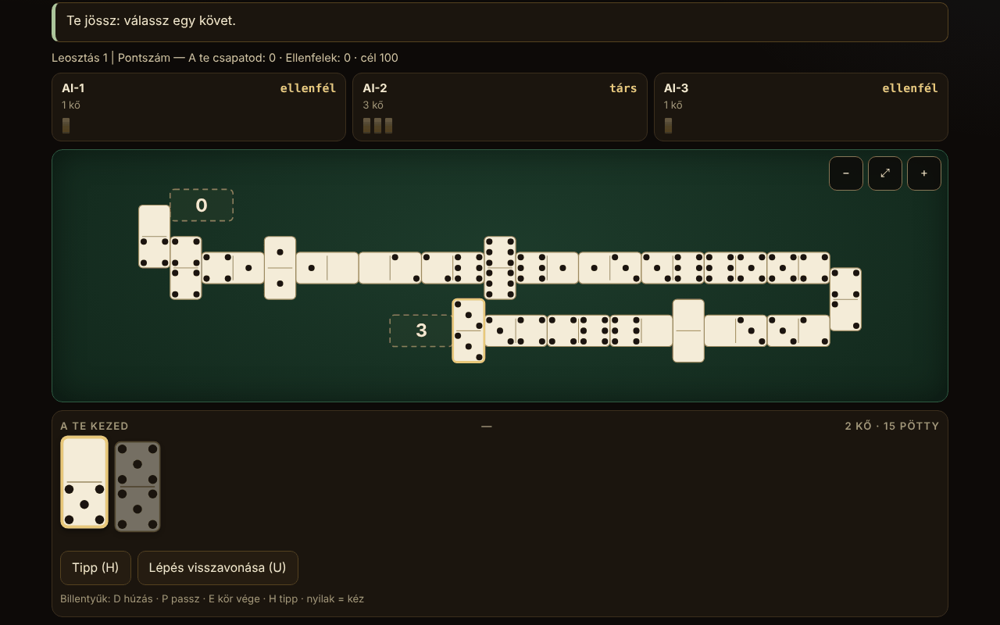

# Domino fără frontiere

[English](README.md) · [Română](README.ro.md) · [Français](README.fr.md) · [Italiano](README.it.md) · [Español](README.es.md) · [Português](README.pt.md) · [Deutsch](README.de.md) · **Magyar**

**Verzió:** 1.2.5 · **Utolsó frissítés:** 2026-10-22

A felület nyelvei: **Română, English, Français, Italiano, Español, Português (PT), Deutsch, Magyar**

Dominóatlasz és játék egy helyi MI ellen: 10 játszható változat (2–4 játékos, 2 a 2 elleni csapatok, ahol a szabály megköveteli) és 5 csak dokumentált lap. Egyetlen HTML-fájl, offline, függőségek nélkül.

**Online alkalmazás:** https://chiuta.github.io/Domino-fara-frontiere/

## Mi ez

A dominó atlasza (eredet, szabályok, közelítések), a megvalósított változatokhoz pedig egy játékasztal, ahol te játszol (0. hely) 1–3 MI-játékos ellen. A szabálymotor ugyanabban a fájlban elkülönül a felülettől, hogy Node-ban tesztelhető legyen. A felület és az atlasz szövegei 8 nyelven érhetők el (lásd a „Nyelvek” szakaszt).

## Funkciók

Csak az, ami a kódban és a tesztekben igazolt:

- 10 játszható változat, egy paraméterezett motor a „soros” játékokhoz (Block, Draw, All Fives, Muggins, Sniff, Fives and Threes, Matador, latin dominó) és külön motor a Mexican Trainhez.
- Dupla-6 (28 kő), dupla-9 (55; csak a Matadorhoz) és dupla-12 (91; Mexican Train és Matador) készletek. A 28/55/91 invariánst a tesztek minden lépésnél ellenőrzik.
- Nagy SVG-kövek, megrajzolt pöttyökkel; a kézben lévő minden kőnek `aria-label` címkéje van „5–3” alakban. „Számjegyek” opció a pöttyök helyett.
- Kígyózó asztal: a sor a szélen egy függőlegesen letett kővel megtörik és irányt vált; nulla kő a képernyőn kívül (32 277 pillanatképen ellenőrizve 8–26 oszlopnyi szélességeknél, átfedés és a szélességből való kilógás nélkül); görgetés és nagyítás (−, igazítás, +), 390 px-en is.
- Négykarú spinner (All Fives, Sniff); személyes vonatok, mexikói vonat, jelölők és nyitott duplák (Mexican Train).
- Első játékos: a kezekben lévő legnagyobb dupla (a latin dominónál a 6-6); húzás a készletből, ahol a szabály megengedi; blokkolás (senki sem tud többet lépni): az nyer, akinek a legkevesebb pontja maradt, az egyes változatok pontozási szabálya szerint (a változat lapján leírva).
- Három, valóban eltérő szintű MI (lásd „Korlátok”): 1 véletlenszerű/mohó, 2 heurisztikák, 3 számolja a kijátszott köveket, és a passzokból kikövetkezteti, mi nincs az ellenfélnél. Az MI csak a nyilvános nézeten + a saját kezén dolgozik.
- Tipp (H), kifejezett „MI-kezek megjelenítése” mód kizárólag tanulásra, opcionális mag (seed) reprodukálható játszmákhoz, helyi statisztikák, világos/sötét téma (az első megnyitáskor a rendszerbeállítást követi), 3 szövegméret, az egyetlen lépés automatikus lejátszása (húzás/passz).
- „Lépés visszavonása” (gomb vagy a U billentyű): visszatér az utolsó lépésed előtti állapotba (legfeljebb 40 lépésig, a közben megtett MI-lépéseket is beleértve; az állapot klónozódik, nem újraszámolódik). Az a játszma, amelyben visszavonást használtál, nem kerül a statisztikákba.
- Véletlenszerűség: `crypto.getRandomValues` elutasításos mintavétellel; maggal mulberry32 (ugyanaz a mintavétel). Fisher–Yates keverés.
- Akadálymentesség: teljes billentyűzetes játék, `aria-live` az állapoton, látható fókusz, érintési célpontok ≥ 44 px (390 px-en mérve; kivétel: az adománylábléc gombjai, ~29 px), a billentyűzetfókusz minden lépés után megmarad, kontraszt ≥ 4,5:1 (mindkét téma színpárjain mérve), `prefers-reduced-motion`, nincs vízszintes görgetés 390 px-en, `<noscript>`, dinamikus `lang`.

## Változatok

| Változat | Játszható? | ⚠ Közelítések (röviden; a teljes szöveg az alkalmazás lapján található) |
|---|---|---|
| Block (húzás nélkül) | igen | – |
| Draw (húzással a készletből) | igen | Kezek 7/7/6 (2/3/4 játékos), 2 kő tartalék (Pagat); ⚠ az önkéntes húzás nem megengedett (csak akkor húzol, ha nem tudsz lépni) |
| All Fives (spinnerrel) | igen | ⚠ a 3–4. kar csak azután nyílik meg, hogy a spinner mindkét oldala fedett (amerikai szokás); kerekítés 5-re az összegen, nem kőnként; 3 játékosnál az egyenlőség a lefelé kerekített felet osztja meg |
| Muggins (All Fives spinner nélkül) | igen | ⚠ a forrás ellentmondásos; az „aki kiment, bezsebel” változatot választottuk; csapatok nélkül |
| Sniff | igen | amerikai változat (keresztbe tett Sniff = spinner); a spinner oldalsó végei addig számítanak, amíg szabadok (a Pagat 8/14/15 példája ellenőrizve); ⚠ a kerekítést és a blokkolást a forrás nem részletezi; csapatok nélkül |
| Fives and Threes | igen | ⚠ csapatok nélkül (a partnerekre vonatkozó „chip out”); a legnagyobb duplával nyit sorsolás helyett; MI: a szintek mérhetően nem különböznek |
| Matador (7-es összeg) | igen | ⚠ a dupla-9/12 matadorjai extrapoláltak; a forrás csak 4 játékost ír le (a 2–3 kiterjesztés); a 7 köves kéz dupla-9/12 esetén is; választott passzszabály: „addig húzol, amíg tudsz lépni, vagy amíg 2 kő marad” |
| Latin dominó 2v2 csapatban, venezuelai stílus, cél 100 | igen | ⚠ a mexikói változat (eltérő blokkolási/kezdési szabályok) nincs megvalósítva; csak a Pagaton leírt változat; a Cuban/Dominican nincs visszaadva; „kéz újrakezdése” nélkül, capicúa/chuchazo/dominao bónuszok nélkül |
| Latin dominó 200 | igen | ⚠ sem tiszta FID, sem tiszta „Doscientos” (hibrid); blokkolás után a nyertes csapat legkevesebb pontú játékosa kezd; 6-6-tal nyit (a FID kövek húzásával választ); „Quinientos” és „Chiva” nélkül |
| Mexican Train (dupla-12, személyes vonatok) | igen | ⚠ 2–4 játékos (a forrás 10-et enged); 1, 3 vagy 13 forduló; az üres dupla 50-nél csak opcióként; MI: a 2. és 3. szint egyformán erős |
| Chicken Foot | csak atlasz | nincs megvalósítva (faszerkezetű elrendezés) |
| Bergen / Double Bergen | csak atlasz | a Bergen-pontozás nincs megvalósítva |
| Five Up | csak atlasz | a teljes szabályokat nem ellenőrizték |
| All Threes | csak atlasz | külön nincs megvalósítva |
| Regionális latin változatok (Quinientos, Milo, Sudan) | csak atlasz | – |

Nem szerepelnek a „színes dominók” (félreérthető kifejezés) és a Sebastopol (a forrásoldal nem volt megtekinthető; semmit nem állítunk róluk).

**A választott latin változat.** A latin csapatdominót több regionális változatban játsszák. Megvalósítottuk a Pagaton leírt venezuelai/mexikói változatot (cél 100, a végén a nyertes viszi az ellenfelek megmaradt köveinek pontjait) és a 200-as változatot (FID/„Doscientos”, az összes megmaradt pontot összeadják, a kéz nyertese nyitja a következőt). A kifejezések: „pase” = a lépésről való lemondás; „pase mutual” = tranque, vagyis az a blokkolás, amelyben senki sem tud többet lépni (a kevesebb pontú csapat nyer, az egyenlőség nem ad pontot); „capot” = győzelem úgy, hogy az ellenfelek nullán vannak (itt választott meghatározás, nem szövetségi norma).

## Használati útmutató

1. Az **Atlaszban** válassz egy változatot, és nyomd meg a „Játék” gombot. A „Szabályok” megmutatja az eredetet, a szabályokat és a közelítéseket.
2. A beállítások ablakban válaszd ki a játékosok számát, a csapatokat (4 főnél), az MI szintjét, esetleg egy magot; nyomd meg a „Játék” gombot.
3. Amikor te jössz, a játszható kövek megemelkednek és kiemelődnek. Nyomj meg egy követ; ha csak egy célja van, azonnal lejátszódik, különben a kéz alatti gombokkal vagy az asztalon egy megjelölt végre nyomva választod ki a célt.
4. Ha nincs lépésed: „Húzás” (D) vagy „Passz” (P). Bekapcsolt „Auto” esetén az egyetlen lépés egy másodperc után automatikusan megtörténik.
5. Mexican Train: az első köröd lehet egy kőlánc a saját vonatodon, majd „Kör befejezése” (E). Egy dupla egy további követ követel; egy nyitott duplát ki kell elégíteni. Ha passzolsz, a jelölődet a vonatra teszed.
6. Billentyűzet: Tab a kézig, nyilak a kövek között, Enter a lépéshez; D, P, E, H (tipp), U (lépés visszavonása). Az Esc bezárja az ablakokat.
7. A sarokban lévő gombok: nyelv, téma, szövegméret, számjegyek, auto, statisztikák, névjegy. Nagyítás az asztalon: −, ⤢, +.

## Nyelvek

A felület elemei (gombok, üzenetek, napló, eredmények) románul, angolul, franciául, olaszul, spanyolul, portugálul, németül és magyarul érhetők el, váltóval és automatikus felismeréssel. **Az atlasz hosszú szövegei (eredet, leírás, szabályok, közelítések mind a 15 lapon) le vannak fordítva mind a 8 nyelvre, és a keresés az aktuális nyelvű nevet és leírást is átfogja. Változatlanul marad: a források listája (hivatkozások/URL-ek; a második sora románul marad) és a latin dominó kifejezései (pase, tranque, capot), a forrásnak megfelelően. A francia, olasz, spanyol, portugál, német és magyar fordítások automatikusak, anyanyelvi beszélők nem ellenőrizték.** A fordítási kulcsok paritását egy szkript ellenőrzi (`tests/i18n-check.js`: 180 kulcs × 7 nyelv, hézagok nélkül, azonos helyőrzőkkel).

## Adatvédelem és hálózat

Nincs telemetria, nincsenek hálózati kérések, nincs `fetch`, nincs `eval`. CSP: `default-src 'none'; script-src 'sha256-…'; style-src 'unsafe-inline'; img-src data:; base-uri 'none'; form-action 'none'` (a szkript hash-sel van lekötve; a `style-src 'unsafe-inline'` a beágyazott stílushoz és a támogatói blokkhoz szükséges). A beállítások és a statisztikák a `localStorage`-ban vannak (`dff1` kulcs), amelyet csak `try/catch`-ben érünk el; nélküle az alkalmazás működik (blokkolt `localStorage`-zsal tesztelve). Az `innerHTML`-t csak egész számokból és az `esc()`-en átvezetett karakterláncokból generált SVG-hez használjuk. Az egyetlen külső hivatkozás a Buy Me a Coffee a támogatói blokkban (`rel="noopener"`), a többi tárolóból azonosan átmásolva.

## Korlátok és figyelmeztetések

- **MI**: nem fér hozzá mások kezéhez. 1. szint: véletlenszerű (vagy pontokra mohó a végeken pontozó játékoknál). 2. szint: heurisztikák (pontok, rugalmasság, duplák, a matadorok megőrzése). 3. szint: ezen felül számolja a kijátszott köveket, a passzokból kikövetkezteti, mi nincs az ellenfélnél, és becsüli annak valószínűségét, hogy az ellenfelek passzolnak. Mért erő (300 játszma, váltakozó helyek): a 3. szint a játszmák 54–98%-ában (változattól függően) veri az 1. szintet, és 52–76%-ában a 2. szintet; a 2. szint 48–98%-ban veri az 1. szintet. **Kivételek**: a Fives and Threesnél a szintek gyakorlatilag egyenlők (~50%), a Mexican Trainnél pedig a 2. és 3. szint egyformán erős (44% a 3. szint javára a 2.-kal szemben), mindkettő egyértelműen veri az 1. szintet (80–85%). Az „MI-kezek megjelenítése” mód kifejezett és csak tanulásra való; az MI egyébként sem néz a te kezedbe.
- Egyes játékok szabályai régiónként eltérnek; a meghozott döntések a ⚠ oszlopban és az alkalmazás lapjain találhatók.
- Nem fogadási eszköz, és a szövetségek számára nincs hivatalos értéke.
- A felületet vizuálisan ellenőriztük Chromiumban (1280×800 és 390×844); Safariban, Firefoxban vagy valódi képernyőolvasókkal nem tesztelték.
- A hálózati többjátékos módot nem valósítottuk meg (és nem is fogjuk: az alkalmazásnak nincs hálózata).

## Tesztek

Minden alábbi a végleges `index.html`-en futott (a szkriptek a csomagon kívül vannak tartva):

- **MI–MI játszmák**, konfigurációnként 500 játszma, lépésről lépésre egy független szabályossági ellenőrző érvényesítette (a szabályokból újraimplementálva, a motor kódja nélkül): Block 2/3/4, Draw 2/3/4, Matador dupla-6/9/12 2/3/4 játékossal, All Fives 2/3/4 + csapatok, Muggins 2/3/4, Sniff 2/3/4, Fives and Threes 2/3/4, latin 100 és latin 200; Mexican Train 2/3/4 × 500 játszma × 13 forduló (19 500 forduló). Eredmény: **0 hiba** (nincs motorleblokkolás, nincs szabálytalan lépés, a 28/55/91 invariáns minden lépésnél, a kezek és a készlet azonosak az ellenőrzőével, a végeken lévő pontok megegyeznek a függetlenül számítottakkal, a kéz végi nyereség azonos).
- **Kézzel írt forgatókönyvek**: 227 ellenőrzés, 0 hiba (All Fives / Muggins / Fives and Threes pontozás a végeken, a végén lévő duplát, a spinnert és a spinner hiányát is beleértve; Mexican Train: nyitott duplák a saját vonaton, más megjelölt/jelöletlen vonatán és a mexikóin, első kör, jelölők, blokkolás, üres dupla 50-nél, 13 forduló; MI a kezekhez való hozzáférés nélkül).
- **Az asztal elrendezése**: 32 277 pillanatkép, 12,7 millió ellenőrzés (nincs átfedés, nincs kilógás a szélességből, helyes kőszám), 8-tól 26 oszlopig terjedő szélességek.
- **Felhasználói felület** (Playwright + Chromium): minden változatnál egy teljes, a felületen át lejátszott játszma 1280 px-en és 390 px-en, 0 konzolhiba, 0 CSP-sértés, 0 külső kérés, nincs vízszintes görgetés; billentyűzetes játék; blokkolt `localStorage`; nyelvfelismerés; érintési célpontok ≥ 44 px (a lábléc kivételével).

## Források

- Pagat.com: Muggins, Block, All Fives, Sniff, Fives and Threes, Matador, Bergen, Latin Partnership Dominoes, Mexican Train, Chicken Foot és a családoldalak (fives family, train family, matador matching, Bergen scoring). A szabályokat a szövegből olvastuk és valósítottuk meg; ahol a forrás ellentmondásos vagy hallgat, a választás ⚠ jelzést kapott.
- A kubai, a dominikai és a Sebastopol változatokhoz nem volt megtekinthető forrás; nem állítjuk, hogy visszaadtuk őket.

## Helyi futtatás

Nyisd meg az `index.html` fájlt egy böngészőben (nem igényel kiszolgálót). A munkaforrásokból való újraépítéshez: `node build.mjs`; a tesztekhez: `node tests/fuzz.js <index.html> 500`, `node tests/scenarios.js <index.html>`, `node tests/layout.js <index.html>`, `node tests/i18n-check.js` (a szkriptek a munkakönyvtárban találhatók, a közzétett csomagon kívül).

## Előzmények / Changelog

### 1.2.5 — 2026-10-22

fff-kit 1.1.4: érintési célok és minimális szövegméret.

### 1.2.4 — 2026-10-22

fff-kit 1.1.2: PBKDF2 600 000 iterációval, clickjacking elleni védelem.

- 1.2.3 — 2026-10-22: mobil és kisegítő finomítások: legalább 12 px-es szöveg és legalább 24 px-es érintési felületek. látható billentyűzetfókusz minden vezérlőn.
- 1.2.2 — 2026-10-22: **javítás**: a források szakasz mostantól minden nyelven le van fordítva.
- 1.2.1 — 2026-10-19: mind a 15 atlaszlap (név, eredet, leírás, szabályok, közelítések; kb. 21 000 karakter) le van fordítva fr, it, es, pt, de, hu nyelvre; a „szöveg angolul” megjegyzés már nem jelenik meg; a keresés az aktuális nyelvű nevet és leírást is átfogja.
- 1.1.0 — 2026-10-14: Biztonsági mentés és adatcímkézés (fff-kit).

- 1.0.0 — 2026-10-12: a verzió és az utolsó frissítés dátuma megjelenik az alkalmazásban (első számozott verzió; a „Névjegy” párbeszédablakban).

7. kör:
- Egy megkezdett (az első lépés után) és be nem fejezett játszma az oldal újratöltésekor vagy bezárásakor mostantól a böngésző megerősítését kéri (`beforeunload`), hogy véletlenül ne veszítsd el a játszmát; „game over” után és az első lépés előtt nem jelenik meg kérdés. A játszma nem kerül mentésre a látogatások között. A CSP-hash újraszámolva; axe-core = 0 szabálysértés 1280 és 360 px-en.
- A „Helyi futtatás” szakaszban szereplő `tests/` csomag és a `build.mjs` a közzétett tárolón kívül marad (ott is jelezve); ellenőrzések: `node --check`, egy játszma a felületen át, 0 konzol-/CSP-hiba.

6. kör:
- Új: „Lépés visszavonása” (U) 40 állapotot tartalmazó veremmel; a visszavonást használó játszmák ki vannak zárva a statisztikákból. A kezdeti téma a `prefers-color-scheme` értéket követi, ha nincs más mentve. A játszmanapló billentyűzettel görgethető (`tabindex`-szel ellátott tájékozódási pont). A CSP-hash újraszámolva.
- Ha olyan követ választottál, amely két végre is tehető, mostantól látható „Válaszd ki, hová teszed …” üzenet jelenik meg a célgombok fölött (korábban csak az állapotüzenet volt).
- Akadálymentesség: az atlasz kártyacímei h2 elemek (helyes sorrend a h1 alatt), a támogatói blokk `complementary` tájékozódási pont; axe-core = 0 szabálysértés 1280 és 360 px-en. A szkript CSP-hash-ét újraszámoltuk.
- Megjegyzés: a README-ben szereplő tesztcsomag (`tests/`) és a `build.mjs` nincs ebben a tárolóban; a módosítás után a `node --check`, egy játszma a felületen át és 0 konzol-/CSP-hiba lett ellenőrizve.

## Licenc

MIT — lásd a `LICENSE` fájlt.

## Kereskedelmi nevek

A „Mexican Train” és más terméknevek tulajdonosaik védjegyei lehetnek; az alkalmazás nem áll kapcsolatban velük, a neveket leíró jelleggel használjuk hagyományos dominószabályokhoz.

## Szerző

Alexandru-Ionuț Chiuță (Alexio).

## Összefoglaló
Egyetlen fájlból álló, offline dominóatlasz tíz játszható változattal egy helyi MI ellen (Block, Draw, All Fives, Muggins, Sniff, Fives and Threes, Matador dupla-6/9/12-n, két latin 2v2 csapatváltozat és Mexican Train dupla-12-n), valamint öt csak dokumentált lappal (Chicken Foot, Bergen, Five Up, All Threes, regionális latin változatok). A szabálymotor tiszta és elkülönül a felülettől, kígyózó asztallal, görgetéssel és nagyítással, teljes billentyűzetes játékkal és 8 nyelvű felülettel (az atlasz hosszú szövegei is le vannak fordítva). Az MI sosem látja a rejtett kezeket (a 3. szint számolja a köveket és a passzokból következtet); a 2. és 3. szint egyformán erős a Mexican Trainnél, a három szint pedig nagyjából egyenlő a Fives and Threesnél. Ellenőrizve konfigurációnként 500 függetlenül érvényesített MI–MI játszmával (0 hiba), 227 kézzel írt szabályforgatókönyvvel (plusz 135 a független auditból) és elrendezés-fuzzinggal. Hálózat és telemetria nélkül, szigorú CSP-vel. Minden közelítés meg van jelölve a változattáblázatban és az alkalmazás szabályaiban. Licenc: MIT (lásd LICENSE). Szabályforrások: Pagat.com.

## Független audit

Egy különálló ellenséges (adversarial) audit javította: a kezeket a Drawnál, a Sniff pontozását, a kezdő játékost blokkolás után a latin 200-nál, egy összeomlást a localStorage-ban sérült statisztikáknál, a billentyűzetfókusz elvesztését, egy tartalék megoldást az MI szabálytalan lépésére. A végleges verzión futtatva: független fuzz (sor + vonat), 135 forgatókönyv, rejtett információ tesztje az MI-nek, 6000 asztal, RNG, i18n, valamint az építő tesztjei.
