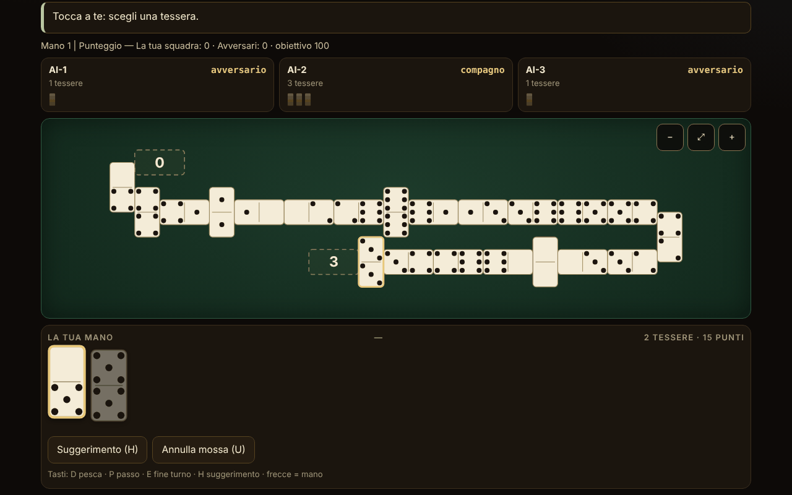

# Domino fără frontiere

[English](README.md) · [Română](README.ro.md) · [Français](README.fr.md) · **Italiano** · [Español](README.es.md) · [Português](README.pt.md) · [Deutsch](README.de.md) · [Magyar](README.hu.md)

**Versione:** 1.2.5 · **Ultimo aggiornamento:** 2026-10-22

Lingue dell'interfaccia: **Română, English, Français, Italiano, Español, Português (PT), Deutsch, Magyar**

Atlante del domino e gioco contro un'IA locale: 10 varianti giocabili (2–4 giocatori, squadre 2 contro 2 dove la regola lo richiede) e 5 schede solo documentate. Un unico file HTML, offline, senza dipendenze.

**Applicazione online:** https://chiuta.github.io/Domino-fara-frontiere/

## Che cos'è

Un atlante del domino (origine, regole, approssimazioni) e, per le varianti implementate, un tavolo da gioco al quale giochi tu (posto 0) contro 1–3 giocatori IA. Il motore delle regole è separato dall'interfaccia nello stesso file, in modo da poter essere testato in Node. L'interfaccia e i testi dell'atlante sono disponibili in 8 lingue (vedi «Lingue»).

## Funzioni

Solo ciò che è verificato nel codice e nei test:

- 10 varianti giocabili, un motore parametrizzato per i giochi «a linea» (Block, Draw, All Fives, Muggins, Sniff, Fives and Threes, Matador, domino latino) e un motore separato per il Mexican Train.
- Set double-6 (28 tessere), double-9 (55; solo per il Matador) e double-12 (91; Mexican Train e Matador). L'invariante 28/55/91 è verificata a ogni mossa nei test.
- Grandi tessere SVG, con i punti disegnati; ogni tessera della mano ha un `aria-label` della forma «5–3». Opzione «Cifre» al posto dei punti.
- Tavolo a serpentina: la linea si spezza al margine con una tessera messa in verticale e cambia verso; zero tessere fuori dallo schermo (verificato su 32.277 istantanee con larghezze da 8 a 26 colonne, senza sovrapposizioni e senza uscite dalla larghezza); scorrimento e zoom (−, adatta, +), anche a 390 px.
- Spinner a quattro bracci (All Fives, Sniff); treni personali, treno messicano, segnalini e doppi aperti (Mexican Train).
- Primo giocatore: il doppio più alto nelle mani (o 6-6 nel domino latino); pesca dal tallone dove la regola lo consente; blocco (nessuno può più giocare): vince chi ha meno punti rimasti, con la regola di punteggio di ciascuna variante (descritta nella scheda della variante).
- IA su tre livelli realmente diversi (vedi «Limiti»): 1 casuale/goloso, 2 euristiche, 3 conta le tessere giocate e deduce dai passi ciò che un avversario non ha. L'IA lavora solo sulla vista pubblica + la propria mano.
- Suggerimento (H), modalità «mostra le mani dell'IA» esplicita e solo per imparare, seme facoltativo per partite riproducibili, statistiche locali, tema chiaro/scuro (alla prima apertura si segue la preferenza di sistema), 3 dimensioni del testo, gioco automatico della mossa unica (pesca/passo).
- «Annulla la mossa» (pulsante o tasto U): torna allo stato precedente alla tua ultima mossa (fino a 40 passi, comprese le mosse dell'IA fatte nel frattempo; lo stato viene clonato, non ricalcolato). Una partita in cui hai usato l'annullamento non entra nelle statistiche.
- Casualità: `crypto.getRandomValues` con campionamento per rifiuto; con il seme, mulberry32 (stesso campionamento). Mescolamento Fisher–Yates.
- Accessibilità: gioco completo da tastiera, `aria-live` sullo stato, focus visibile, bersagli tattili ≥ 44 px (misurato a 390 px; eccezione: i pulsanti nel piè di pagina delle donazioni, ~29 px), focus da tastiera mantenuto dopo ogni mossa, contrasto ≥ 4,5:1 (misurato sulle coppie di colori di entrambi i temi), `prefers-reduced-motion`, nessuno scorrimento orizzontale a 390 px, `<noscript>`, `lang` dinamico.

## Varianti

| Variante | Giocabile? | ⚠ Approssimazioni (in breve; il testo completo è nella scheda dell'applicazione) |
|---|---|---|
| Block (senza pesca) | sì | – |
| Draw (con pesca dal tallone) | sì | Mani 7/7/6 (2/3/4 giocatori), riserva di 2 tessere (Pagat); ⚠ la pesca volontaria non è consentita (si pesca solo quando non si può giocare) |
| All Fives (con spinner) | sì | ⚠ i bracci 3–4 si aprono solo dopo che lo spinner ha entrambi i lati coperti (uso americano); arrotondamento a 5 sul totale, non tessera per tessera; con 3 giocatori, la parità divide la metà arrotondata per difetto |
| Muggins (All Fives senza spinner) | sì | ⚠ la fonte è incoerente; si è scelto «chi esce incassa»; senza squadre |
| Sniff | sì | variante americana (Sniff trasversale = spinner); le estremità laterali dello spinner si contano finché sono libere (l'esempio 8/14/15 di Pagat verificato); ⚠ arrotondamento e blocco non precisati dalla fonte; senza squadre |
| Fives and Threes | sì | ⚠ senza squadre («chip out» sui partner); apre con il doppio più alto invece del sorteggio; IA: i livelli non differiscono in modo misurabile |
| Matador (somma 7) | sì | ⚠ i matador per double-9/12 sono estrapolati; la fonte descrive solo 4 giocatori (2–3 è un'estensione); mano di 7 tessere anche a double-9/12; regola del passo scelta: «peschi finché puoi giocare o restano 2 tessere» |
| Domino latino a squadre 2v2, stile venezuelano, obiettivo 100 | sì | ⚠ la versione messicana (regole di blocco/avvio diverse) non è implementata; solo la variante descritta su Pagat; Cuban/Dominican non sono riprodotte; senza «rifare la mano», senza bonus capicúa/chuchazo/dominao |
| Domino latino 200 | sì | ⚠ né FID puro, né «Doscientos» puro (ibrido); dopo un blocco inizia il giocatore con meno punti della squadra vincente; apre con 6-6 (la FID sceglie estraendo le tessere); senza «Quinientos» e «Chiva» |
| Mexican Train (double-12, treni personali) | sì | ⚠ 2–4 giocatori (la fonte ne consente 10); 1, 3 o 13 giri; il doppio-bianco a 50 solo come opzione; IA: i livelli 2 e 3 sono ugualmente forti |
| Chicken Foot | solo atlante | non implementato (disposizione ad albero) |
| Bergen / Double Bergen | solo atlante | il punteggio Bergen non è implementato |
| Five Up | solo atlante | le regole complete non sono state verificate |
| All Threes | solo atlante | non implementato separatamente |
| Varianti latine regionali (Quinientos, Milo, Sudan) | solo atlante | – |

Non sono inclusi i «domino colorati» (termine ambiguo) e il Sebastopol (la pagina della fonte non ha potuto essere consultata; non si afferma nulla su di essi).

**La variante latina scelta.** Il domino latino a squadre si gioca in diverse versioni regionali. È stata implementata la versione venezuelana/messicana descritta su Pagat (obiettivo 100, alla fine il vincitore prende i punti delle tessere rimaste agli avversari) e la versione da 200 (FID/«Doscientos», si sommano tutti i punti rimasti, il vincitore della mano apre la successiva). I termini: «pase» = astenersi dal muovere; «pase mutual» = tranque, cioè il blocco in cui nessuno può più giocare (vince la squadra con meno punti, la parità non dà punti); «capot» = vittoria con gli avversari a zero (definizione scelta qui, non norma federale).

## Guida all'uso

1. Nell'**Atlante**, scegli una variante e premi «Gioca». «Regole» mostra l'origine, le regole e le approssimazioni.
2. Nella finestra delle impostazioni scegli il numero di giocatori, le squadre (a 4), il livello dell'IA, eventualmente un seme; premi «Gioca».
3. Quando tocca a te, le tessere giocabili sono sollevate ed evidenziate. Premi una tessera; se ha una sola destinazione viene giocata subito, altrimenti scegli la destinazione con i pulsanti sotto la mano o premendo un'estremità segnata sul tavolo.
4. Se non hai mosse: «Pesca» (D) o «Passa» (P). Con «Auto» attivo, la mossa unica viene fatta automaticamente dopo un secondo.
5. Mexican Train: il tuo primo turno può essere una catena di tessere sul tuo treno, poi «Termina il turno» (E). Un doppio richiede una tessera in più; un doppio aperto deve essere soddisfatto. Quando passi, metti il tuo segnalino sul treno.
6. Tastiera: Tab fino alla mano, frecce tra le tessere, Invio per giocare; D, P, E, H (suggerimento), U (annulla la mossa). Esc chiude le finestre.
7. I pulsanti nell'angolo: lingua, tema, dimensione del testo, cifre, auto, statistiche, informazioni. Zoom sul tavolo: −, ⤢, +.

## Lingue

Gli elementi dell'interfaccia (pulsanti, messaggi, registro, risultati) sono in rumeno, inglese, francese, italiano, spagnolo, portoghese, tedesco e ungherese, con selettore e rilevamento automatico. **I testi lunghi dell'atlante (origine, descrizione, regole, approssimazioni di tutte le 15 schede) sono tradotti in tutte le 8 lingue, e la ricerca include il nome e la descrizione nella lingua corrente. Restano invariati: l'elenco delle fonti (citazioni/URL; la seconda riga resta in rumeno) e i termini del domino latino (pase, tranque, capot), mantenuti come nella fonte. Le traduzioni in francese, italiano, spagnolo, portoghese, tedesco e ungherese sono automatiche, non verificate da madrelingua.** La parità delle chiavi di traduzione è verificata con uno script (`tests/i18n-check.js`: 180 chiavi × 7 lingue, senza lacune, stessi segnaposto).

## Privacy e rete

Nessuna telemetria, nessuna richiesta di rete, nessun `fetch`, nessun `eval`. CSP: `default-src 'none'; script-src 'sha256-…'; style-src 'unsafe-inline'; img-src data:; base-uri 'none'; form-action 'none'` (lo script è vincolato tramite hash; `style-src 'unsafe-inline'` è necessario per lo stile inline e per il blocco di sostegno). Le preferenze e le statistiche sono conservate in `localStorage` (chiave `dff1`), a cui si accede solo in `try/catch`; senza di esso l'applicazione funziona (testato con `localStorage` bloccato). `innerHTML` è usato solo per SVG generato da interi e da stringhe passate per `esc()`. Gli unici link esterni sono Buy Me a Coffee nel blocco di sostegno (`rel="noopener"`), copiato identico dagli altri repository.

## Limiti e avvertenze

- **IA**: non ha accesso alle mani degli altri. Livello 1: casuale (o goloso sui punti nei giochi con punteggio alle estremità). Livello 2: euristiche (punti, flessibilità, doppi, conservazione dei matador). Livello 3: in più conta le tessere giocate, deduce dai passi ciò che un avversario non ha e stima la probabilità che gli avversari passino. Forza misurata (300 partite, posti alternati): il livello 3 batte il livello 1 nel 54–98% delle partite (a seconda della variante) e il livello 2 nel 52–76%; il livello 2 batte il livello 1 nel 48–98%. **Eccezioni**: a Fives and Threes i livelli sono praticamente pari (~50%), e al Mexican Train i livelli 2 e 3 sono ugualmente forti (44% per il livello 3 contro il 2), entrambi battono nettamente il livello 1 (80–85%). La modalità «mostra le mani dell'IA» è esplicita e solo per imparare; l'IA comunque non guarda la tua mano.
- Le regole di alcuni giochi differiscono da regione a regione; le scelte fatte sono nella colonna ⚠ e nelle schede dell'applicazione.
- Non è uno strumento di scommesse e non ha valore ufficiale per le federazioni.
- L'interfaccia è stata verificata visivamente in Chromium (1280×800 e 390×844); non è stata testata su Safari, Firefox né con veri lettori di schermo.
- La modalità multigiocatore in rete non è stata implementata (e non lo sarà: l'applicazione non ha rete).

## Test

Tutto quanto segue è stato eseguito sull'`index.html` finale (gli script sono conservati fuori dal pacchetto):

- **Partite IA contro IA**, 500 partite per configurazione, convalidate passo per passo da un validatore di legalità indipendente (reimplementato dalle regole, senza codice del motore): Block 2/3/4, Draw 2/3/4, Matador double-6/9/12 a 2/3/4, All Fives 2/3/4 + squadre, Muggins 2/3/4, Sniff 2/3/4, Fives and Threes 2/3/4, latino 100 e latino 200; Mexican Train 2/3/4 × 500 partite × 13 giri (19.500 giri). Risultato: **0 fallimenti** (nessun blocco del motore, nessuna mossa illegale, invariante 28/55/91 a ogni mossa, mani e tallone identici al validatore, punti alle estremità uguali a quelli calcolati in modo indipendente, vincita di fine mano identica).
- **Scenari scritti a mano**: 227 verifiche, 0 fallimenti (punteggio All Fives / Muggins / Fives and Threes sulle estremità, compreso doppio all'estremità, spinner e assenza di spinner; Mexican Train: doppi aperti sul proprio treno, su quello altrui segnato/non segnato e su quello messicano, primo turno, segnalini, blocco, doppio-bianco a 50, 13 giri; IA senza accesso alle mani).
- **Disposizione del tavolo**: 32.277 istantanee, 12,7 milioni di verifiche (nessuna sovrapposizione, nessuna uscita dalla larghezza, numero corretto di tessere), larghezze da 8 a 26 colonne.
- **UI** (Playwright + Chromium): una partita completa giocata tramite l'interfaccia per ogni variante a 1280 px e 390 px, 0 errori in console, 0 violazioni CSP, 0 richieste esterne, nessuno scorrimento orizzontale; gioco da tastiera; `localStorage` bloccato; rilevamento automatico della lingua; bersagli tattili ≥ 44 px (tranne il piè di pagina).

## Fonti

- Pagat.com: Muggins, Block, All Fives, Sniff, Fives and Threes, Matador, Bergen, Latin Partnership Dominoes, Mexican Train, Chicken Foot e le pagine di famiglia (fives family, train family, matador matching, Bergen scoring). Le regole sono state lette e implementate dal testo; dove la fonte è incoerente o tace, la scelta è segnata ⚠.
- Per le versioni cubana, dominicana e Sebastopol non è stato possibile consultare una fonte; non si afferma che siano riprodotte.

## Esecuzione locale

Apri `index.html` in un browser (non richiede un server). Per ricostruire dalle sorgenti di lavoro: `node build.mjs`; per i test: `node tests/fuzz.js <index.html> 500`, `node tests/scenarios.js <index.html>`, `node tests/layout.js <index.html>`, `node tests/i18n-check.js` (gli script si trovano nella directory di lavoro, fuori dal pacchetto pubblicato).

## Cronologia / Changelog

### 1.2.5 — 2026-10-22

fff-kit 1.1.4: aree tattili e testo minimo.

### 1.2.4 — 2026-10-22

fff-kit 1.1.2: PBKDF2 a 600.000 iterazioni, protezione anti-clickjacking.

- 1.2.3 — 2026-10-22: rifiniture per mobile e accessibilità: testo di almeno 12 px e aree tattili di almeno 24 px. focus da tastiera visibile su ogni controllo.
- 1.2.2 — 2026-10-22: **correzione**: la sezione delle fonti è ora tradotta in tutte le lingue.
- 1.2.1 — 2026-10-19: tutte le 15 schede dell'atlante (nome, origine, descrizione, regole, approssimazioni; circa 21.000 caratteri) sono tradotte in fr, it, es, pt, de, hu; la nota «testo in inglese» non compare più; la ricerca include il nome e la descrizione nella lingua corrente.
- 1.1.0 — 2026-10-14: Copia di riserva ed etichettatura dei dati (fff-kit).

- 1.0.0 — 2026-10-12: la versione e la data dell'ultimo aggiornamento sono mostrate nell'applicazione (prima versione numerata; nella finestra «Informazioni»).

Giro 7:
- Una partita iniziata (dopo la prima mossa) e non terminata richiede ora la conferma del browser al ricaricamento o alla chiusura della pagina (`beforeunload`), per non perdere accidentalmente la partita; dopo «game over» e prima della prima mossa non compare alcuna domanda. La partita non viene salvata tra le visite. Hash CSP ricalcolato; axe-core = 0 violazioni a 1280 e 360 px.
- La suite `tests/` e `build.mjs` della sezione «Esecuzione locale» restano fuori dal repository pubblicato (dichiarato anche lì); verifiche: `node --check`, una partita tramite l'interfaccia, 0 errori di console/CSP.

Giro 6:
- Novità: «Annulla la mossa» (U) con una pila di 40 stati; le partite con annullamento sono escluse dalle statistiche. Il tema iniziale segue `prefers-color-scheme` se non ne è salvato un altro. Il registro della partita può essere fatto scorrere da tastiera (punto di riferimento con `tabindex`). Hash CSP ricalcolato.
- Quando hai scelto una tessera che può essere posta a due estremità, compare ora un messaggio visibile «Scegli dove metterla …» sopra i pulsanti di destinazione (prima c'era solo il messaggio di stato).
- Accessibilità: i titoli delle schede nell'atlante sono h2 (ordine corretto sotto h1), il blocco di sostegno è un punto di riferimento `complementary`; axe-core = 0 violazioni a 1280 e 360 px. L'hash CSP dello script è stato ricalcolato.
- Nota: la suite di test del README (`tests/`) e `build.mjs` non si trovano in questo repository; dopo la modifica sono stati verificati `node --check`, una partita tramite l'interfaccia e 0 errori di console/CSP.

## Licenza

MIT — vedi il file `LICENSE`.

## Nomi commerciali

«Mexican Train» e altri nomi di prodotto possono essere marchi dei rispettivi titolari; l'applicazione non è affiliata con essi, e i nomi sono usati a scopo descrittivo per regole tradizionali del domino.

## Autore

Alexandru-Ionuț Chiuță (Alexio).

## Riepilogo
Un atlante del domino in un unico file, offline, con dieci varianti giocabili contro un'IA locale (Block, Draw, All Fives, Muggins, Sniff, Fives and Threes, Matador su double-6/9/12, due versioni latine a squadre 2v2 e Mexican Train su double-12) più cinque schede solo documentate (Chicken Foot, Bergen, Five Up, All Threes, versioni latine regionali). Il motore delle regole è puro e separato dall'interfaccia, con tavolo a serpentina, scorrimento e zoom, gioco completo da tastiera e interfaccia in 8 lingue (anche i testi lunghi dell'atlante sono tradotti). L'IA non vede mai le mani nascoste (il livello 3 conta le tessere e deduce dai passi); i livelli 2 e 3 sono ugualmente forti al Mexican Train, e tutti e tre sono più o meno pari a Fives and Threes. Verificato con 500 partite IA contro IA convalidate in modo indipendente per configurazione (0 fallimenti), 227 scenari di regole scritti a mano (più 135 dell'audit indipendente) e fuzzing della disposizione. Nessuna rete, nessuna telemetria, CSP rigorosa. Ogni approssimazione è segnata nella tabella delle varianti e nelle regole dell'applicazione. Licenza: MIT (vedi LICENSE). Fonti delle regole: Pagat.com.

## Audit indipendente

Un audit avversariale separato ha corretto: le mani a Draw, il punteggio dello Sniff, il giocatore che inizia dopo un blocco nel latino 200, un crash con statistiche danneggiate in localStorage, la perdita del focus da tastiera, un ripiego per una mossa illegale dell'IA. Eseguito sulla versione finale: fuzz indipendente (linea + treno), 135 scenari, test di informazione nascosta per l'IA, 6000 tavoli, RNG, i18n, più i test del costruttore.
