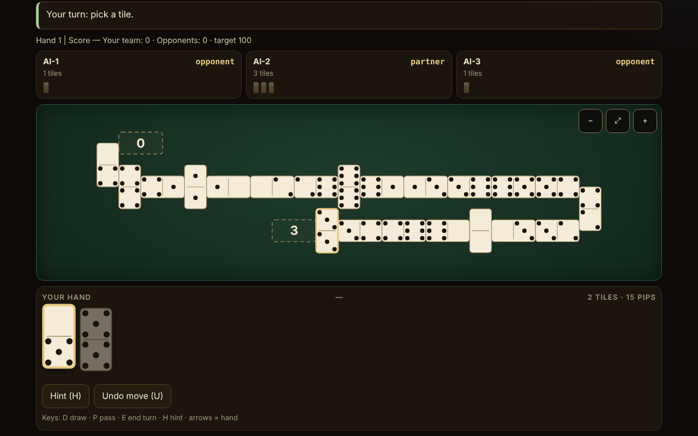

# Domino fără frontiere

**English** · [Română](README.ro.md) · [Français](README.fr.md) · [Italiano](README.it.md) · [Español](README.es.md) · [Português](README.pt.md) · [Deutsch](README.de.md) · [Magyar](README.hu.md)

**Version:** 1.2.5 · **Last updated:** 2026-10-22

Interface languages: **Română, English, Français, Italiano, Español, Português (PT), Deutsch, Magyar**

A domino atlas and a game against a local AI: 10 playable variants (2–4 players, 2-versus-2 teams where the rule requires it) and 5 documented-only entries. A single HTML file, offline, no dependencies.

**Live app:** https://chiuta.github.io/Domino-fara-frontiere/

## What it is

An atlas of dominoes (origin, rules, approximations) and, for the implemented variants, a game table where you play (seat 0) against 1–3 AI players. The rules engine is separated from the interface in the same file, so that it can be tested in Node. The interface and the atlas texts are available in 8 languages (see "Languages").

## Features

Only what is verified in the code and in the tests:

- 10 playable variants, a parameterised engine for the "line" games (Block, Draw, All Fives, Muggins, Sniff, Fives and Threes, Matador, Latin domino) and a separate engine for Mexican Train.
- Sets of double-6 (28 tiles), double-9 (55; Matador only) and double-12 (91; Mexican Train and Matador). The 28/55/91 invariant is verified at every move in the tests.
- Large SVG tiles, with the pips drawn; each tile in the hand has an `aria-label` of the form "5–3". A "Digits" option instead of pips.
- Snaking table: the line breaks at the edge with a tile placed vertically and changes direction; zero tiles off-screen (verified on 32,277 snapshots at widths of 8–26 columns, with no overlaps and no overflow of the width); scroll and zoom (−, fit, +), including at 390 px.
- Spinner with four arms (All Fives, Sniff); personal trains, the Mexican train, markers and open doubles (Mexican Train).
- First player: the highest double in the hands (or 6-6 in Latin domino); drawing from the boneyard where the rule allows it; blocked game (nobody can play any more): whoever has the fewest points left wins, with each variant's scoring rule (described in the variant's sheet).
- AI at three levels that really differ (see "Limits"): 1 random/greedy, 2 heuristics, 3 counts the tiles played and deduces from passes what an opponent does not have. The AI works only on the public view + its own hand.
- Hint (H), an explicit "show the AI hands" mode only for learning, an optional seed for reproducible games, local statistics, light/dark theme (on first opening the system preference is followed), 3 text sizes, auto-play of the single move (draw/pass).
- "Undo move" (button or the U key): goes back to the state before your last move (up to 40 steps, including the AI moves made in the meantime; the state is cloned, not recomputed). A game in which you used undo does not count in the statistics.
- Randomness: `crypto.getRandomValues` with rejection sampling; with a seed, mulberry32 (the same sampling). Fisher–Yates shuffle.
- Accessibility: full keyboard play, `aria-live` on the status, visible focus, touch targets ≥ 44 px (measured at 390 px; exception: the buttons in the donation footer, ~29 px), keyboard focus kept after every move, contrast ≥ 4.5:1 (measured on the colour pairs of both themes), `prefers-reduced-motion`, no horizontal scroll at 390 px, `<noscript>`, dynamic `lang`.

## Variants

| Variant | Playable? | ⚠ Approximations (in brief; the full text is in the in-app sheet) |
|---|---|---|
| Block (no drawing) | yes | – |
| Draw (drawing from the boneyard) | yes | Hands 7/7/6 (2/3/4 players), a reserve of 2 tiles (Pagat); ⚠ voluntary drawing is not allowed (you draw only when you cannot play) |
| All Fives (with spinner) | yes | ⚠ arms 3–4 open only after the spinner has both sides covered (American usage); rounding to 5 on the total, not tile by tile; with 3 players, a tie splits half rounded down |
| Muggins (All Fives without spinner) | yes | ⚠ the source is inconsistent; "whoever goes out collects" was chosen; no teams |
| Sniff | yes | the American variant (transverse Sniff = spinner); the side ends of the spinner are counted while they are free (the 8/14/15 example on Pagat verified); ⚠ rounding and blocking not specified by the source; no teams |
| Fives and Threes | yes | ⚠ no teams ("chip out" on partners); opens with the highest double instead of drawing lots; AI: the levels do not measurably differ |
| Matador (sum 7) | yes | ⚠ the matadors for double-9/12 are extrapolated; the source describes only 4 players (2–3 is an extension); the 7-tile hand also at double-9/12; the pass rule chosen: "you draw until you can play or 2 tiles remain" |
| Latin domino in 2v2 teams, Venezuelan style, target 100 | yes | ⚠ the Mexican version (different blocking/start rules) is not implemented; only the variant described on Pagat; Cuban/Dominican are not reproduced; no "hand redo", no capicúa/chuchazo/dominao bonuses |
| Latin domino 200 | yes | ⚠ neither pure FID nor pure "Doscientos" (a hybrid); after a block the player with the fewest points from the winning team starts; opens with 6-6 (FID chooses by drawing tiles); no "Quinientos" and "Chiva" |
| Mexican Train (double-12, personal trains) | yes | ⚠ 2–4 players (the source allows 10); 1, 3 or 13 rounds; the blank double at 50 only as an option; AI: levels 2 and 3 are equally strong |
| Chicken Foot | atlas only | not implemented (tree arrangement) |
| Bergen / Double Bergen | atlas only | Bergen scoring is not implemented |
| Five Up | atlas only | the full rules were not verified |
| All Threes | atlas only | not implemented separately |
| Regional Latin variants (Quinientos, Milo, Sudan) | atlas only | – |

"Colour dominoes" (an ambiguous term) and Sebastopol are not included (the source page could not be consulted; nothing is claimed about them).

**The Latin variant chosen.** Latin partnership dominoes are played in several regional versions. The Venezuelan/Mexican version described on Pagat was implemented (target 100, at the end the winner takes the points of the opponents' remaining tiles) and the 200 version (FID/"Doscientos", all remaining points are added up, the winner of the hand opens the next). The terms: "pase" = abstaining from a move; "pase mutual" = tranque, that is the block in which nobody can play any more (the team with fewer points wins, a tie gives no points); "capot" = victory with the opponents at zero (a definition chosen here, not a federal norm).

## User guide

1. In the **Atlas**, choose a variant and press "Play". "Rules" shows the origin, the rules and the approximations.
2. In the settings window choose the number of players, the teams (at 4), the AI level, possibly a seed; press "Play".
3. When it is your turn, the playable tiles are raised and highlighted. Press a tile; if it has a single destination it is played immediately, otherwise you choose the destination with the buttons under the hand or by pressing a marked end on the table.
4. If you have no move: "Draw" (D) or "Pass" (P). With "Auto" on, the single move is made automatically after a second.
5. Mexican Train: your first turn can be a chain of tiles on your train, then "End turn" (E). A double requires an extra tile; an open double must be satisfied. When you pass, you put your marker on the train.
6. Keyboard: Tab to the hand, arrows between tiles, Enter to play; D, P, E, H (hint), U (undo move). Esc closes the windows.
7. The buttons in the corner: language, theme, text size, digits, auto, statistics, about. Zoom on the table: −, ⤢, +.

## Languages

The interface elements (buttons, messages, log, results) are in Romanian, English, French, Italian, Spanish, Portuguese, German and Hungarian, with a switcher and auto-detection. **The long atlas texts (origin, description, rules, approximations of all 15 sheets) are translated into all 8 languages, and the search covers the name and the description in the current language. Left as they are: the list of sources (citations/URLs; its second line stays in Romanian) and the Latin-domino terms (pase, tranque, capot), kept as in the source. The French, Italian, Spanish, Portuguese, German and Hungarian translations are automatic and not verified by native speakers.** The parity of the translation keys is verified with a script (`tests/i18n-check.js`: 180 keys × 7 languages, no gaps, the same placeholders).

## Privacy and network

No telemetry, no network requests, no `fetch`, no `eval`. CSP: `default-src 'none'; script-src 'sha256-…'; style-src 'unsafe-inline'; img-src data:; base-uri 'none'; form-action 'none'` (the script is bound by hash; `style-src 'unsafe-inline'` is needed for the inline style and for the support block). Preferences and statistics are kept in `localStorage` (key `dff1`), accessed only in `try/catch`; without it the app works (tested with `localStorage` blocked). `innerHTML` is used only for SVG generated from integers and strings passed through `esc()`. The only external links are Buy Me a Coffee in the support block (`rel="noopener"`), copied identically from the other repos.

## Limits and warnings

- **AI**: it has no access to other people's hands. Level 1: random (or greedy on points in the games scoring on the ends). Level 2: heuristics (points, flexibility, doubles, keeping the matadors). Level 3: additionally counts the tiles played, deduces from passes what an opponent does not have, and estimates the probability that the opponents will pass. The measured strength (300 games, alternating seats): level 3 beats level 1 in 54–98% of games (depending on the variant) and level 2 in 52–76%; level 2 beats level 1 in 48–98%. **Exceptions**: in Fives and Threes the levels are practically equal (~50%), and in Mexican Train levels 2 and 3 are equally strong (44% for level 3 against 2), both clearly beat level 1 (80–85%). The "show the AI hands" mode is explicit and only for learning; the AI does not look at your hand anyway.
- The rules of some games differ from region to region; the choices made are in the ⚠ column and in the in-app sheets.
- It is not a betting tool and has no official value for federations.
- The interface was checked visually in Chromium (1280×800 and 390×844); it was not tested on Safari, Firefox or with real screen readers.
- Networked multiplayer mode was not implemented (and will not be: the app has no network).

## Tests

All of the following was run on the final `index.html` (the scripts are kept outside the package):

- **AI-versus-AI games**, 500 games per configuration, validated step by step by an independent legality validator (reimplemented from the rules, without code from the engine): Block 2/3/4, Draw 2/3/4, Matador double-6/9/12 at 2/3/4, All Fives 2/3/4 + teams, Muggins 2/3/4, Sniff 2/3/4, Fives and Threes 2/3/4, Latin 100 and Latin 200; Mexican Train 2/3/4 × 500 games × 13 rounds (19,500 rounds). Result: **0 failures** (no engine deadlocks, no illegal moves, the 28/55/91 invariant at every move, hands and boneyard identical to the validator, the end points equal to those computed independently, the end-of-hand win identical).
- **Hand-written scenarios**: 227 checks, 0 failures (All Fives / Muggins / Fives and Threes scoring on the ends, including a double at the end, spinner and absence of the spinner; Mexican Train: open doubles on one's own train, on another's marked/unmarked one and on the Mexican one, first turn, markers, block, the blank double at 50, 13 rounds; AI without access to the hands).
- **Table layout**: 32,277 snapshots, 12.7 million checks (no overlaps, no overflow of the width, correct number of tiles), widths from 8 to 26 columns.
- **UI** (Playwright + Chromium): one complete game played through the interface for each variant at 1280 px and 390 px, 0 console errors, 0 CSP violations, 0 external requests, no horizontal scroll; keyboard play; `localStorage` blocked; language auto-detection; touch targets ≥ 44 px (except the footer).

## Sources

- Pagat.com: Muggins, Block, All Fives, Sniff, Fives and Threes, Matador, Bergen, Latin Partnership Dominoes, Mexican Train, Chicken Foot and the family pages (fives family, train family, matador matching, Bergen scoring). The rules were read and implemented from the text; where the source is inconsistent or silent, the choice is marked ⚠.
- For the Cuban, Dominican and Sebastopol versions no source could be consulted; it is not claimed that they are reproduced.

## Running locally

Open `index.html` in a browser (it does not need a server). To rebuild from the working sources: `node build.mjs`; for tests: `node tests/fuzz.js <index.html> 500`, `node tests/scenarios.js <index.html>`, `node tests/layout.js <index.html>`, `node tests/i18n-check.js` (the scripts are in the working directory, outside the published package).

## History / Changelog

### 1.2.5 — 2026-10-22

fff-kit 1.1.4: touch targets and minimum text size.

### 1.2.4 — 2026-10-22

fff-kit 1.1.2: PBKDF2 with 600,000 iterations, anti-clickjacking protection.

- 1.2.3 — 2026-10-22: mobile and accessibility polish: text at least 12 px and touch targets at least 24 px. visible keyboard focus on every control.
- 1.2.2 — 2026-10-22: **fix**: the sources section is now translated into every language.
- 1.2.1 — 2026-10-19: all 15 atlas sheets (name, origin, description, rules, approximations; about 21,000 characters) are translated into fr, it, es, pt, de, hu; the "text in English" note no longer appears; the search covers the name and description in the current language.
- 1.1.0 — 2026-10-14: Backup and data labelling (fff-kit).

- 1.0.0 — 2026-10-12: the version and the date of the last update are shown in the app (first numbered version; in the "About" dialog).

Round 7:
- A game that has started (after the first move) and is not finished now asks for the browser's confirmation on reloading or closing the page (`beforeunload`), so that you do not lose the game by accident; after "game over" and before the first move no question appears. The game is not saved between visits. The CSP hash recalculated; axe-core = 0 violations at 1280 and 360 px.
- The `tests/` suite and `build.mjs` from the "Running locally" section remain outside the published repository (stated there too); checks: `node --check`, one game through the interface, 0 console/CSP errors.

Round 6:
- New: "Undo move" (U) with a stack of 40 states; games with undo are excluded from the statistics. The initial theme follows `prefers-color-scheme` if no other is saved. The game log can be scrolled from the keyboard (landmark with `tabindex`). The CSP hash recalculated.
- When you have chosen a tile that can be placed at two ends, a visible message "Choose where to place …" now appears above the destination buttons (before there was only the status message).
- Accessibility: the card titles in the atlas are h2 (correct order under h1), the support block is a `complementary` landmark; axe-core = 0 violations at 1280 and 360 px. The script's CSP hash was recalculated.
- Note: the test suite from the README (`tests/`) and `build.mjs` are not in this repository; after the change `node --check`, one game through the interface and 0 console/CSP errors were verified.

## License

MIT — see the `LICENSE` file.

## Trade names

"Mexican Train" and other product names may be trademarks of their holders; the app is not affiliated with them, and the names are used descriptively for traditional domino rules.

## Author

Alexandru-Ionuț Chiuță (Alexio).

## Independent audit

A separate adversarial audit corrected: the hands in Draw, Sniff scoring, the starting player after a block in Latin 200, a crash on statistics corrupted in localStorage, loss of keyboard focus, a fallback for an illegal AI move. Run on the final version: independent fuzz (line + train), 135 scenarios, a hidden-information test for the AI, 6000 boards, RNG, i18n, plus the builder's tests.
