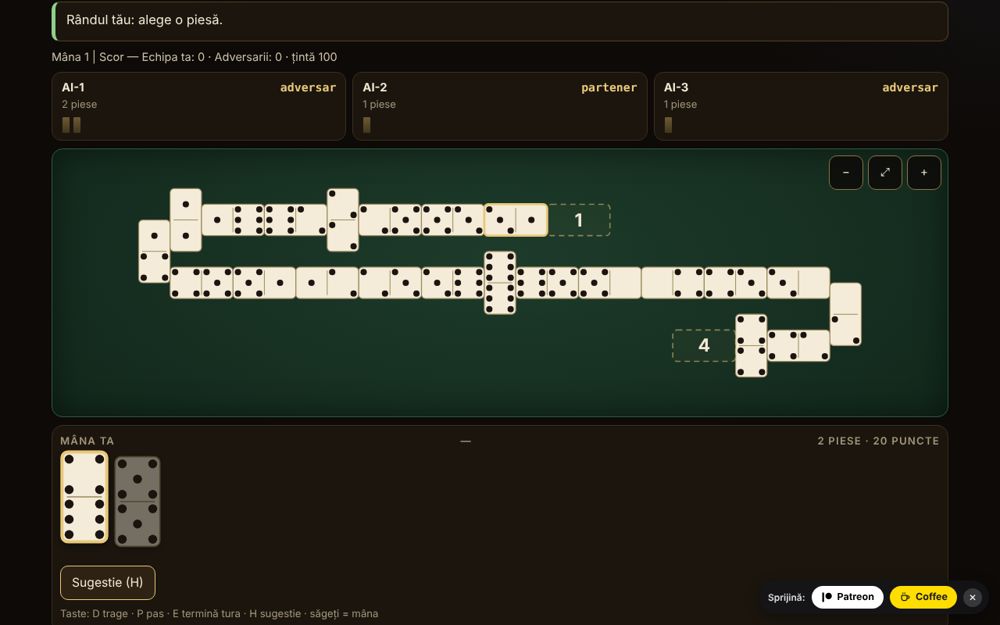

# Domino fără frontiere

Atlas de domino și joc contra unui AI local: 10 variante jucabile (2–4 jucători, echipe 2 contra 2 unde regula o cere) și 5 fișe doar documentate. Un singur fișier HTML, offline, fără dependențe.

**Live:** https://chiuta.github.io/Domino-fara-frontiere/

## Ce este

Un atlas al dominoului (origine, reguli, aproximări) și, pentru variantele implementate, o masă de joc la care joci tu (locul 0) contra a 1–3 jucători AI. Motorul de reguli este separat de interfață în același fișier, ca să poată fi testat în Node. Interfața este în română și în încă 6 limbi (vezi „Limbi”).

## Funcții

Doar ce este verificat în cod și în teste:

- 10 variante jucabile, un motor parametrizat pentru „linie” (Block, Draw, All Fives, Muggins, Sniff, Fives and Threes, Matador, domino latin) și un motor separat pentru Mexican Train.
- Seturi double-6 (28 de piese), double-9 (55; doar la Matador) și double-12 (91; Mexican Train și Matador). Invariantul 28/55/91 este verificat la fiecare mutare în teste.
- Piese SVG mari, cu punctele desenate; fiecare piesă din mână are `aria-label` de forma „5–3”. Opțiune „Cifre” în loc de puncte.
- Masă în serpentină: linia se rupe la margine cu o piesă pusă pe verticală și își schimbă sensul; zero piese în afara ecranului (verificat pe 32 277 de instantanee la lățimi de 8–26 de coloane, fără suprapuneri și fără ieșiri din lățime); derulare și zoom (−, potrivire, +), inclusiv pe 390 px.
- Spinner cu patru brațe (All Fives, Sniff); trenuri personale, tren mexican, marcaje și dubluri deschise (Mexican Train).
- Primul jucător: cel mai mare dublu din mâini (sau 6-6 la dominoul latin); tragere din boneyard acolo unde regula o permite; blocaj (nimeni nu mai poate juca): câștigă cine are cele mai puține puncte rămase, cu regula de scor a fiecărei variante (descrisă în fișa variantei).
- AI în trei niveluri care diferă real (vezi „Limite”): 1 aleatoriu/lacom, 2 euristici, 3 numără piesele jucate și deduce din pase ce nu are un adversar. AI-ul lucrează numai pe vederea publică + propria mână.
- Sugestie (H), mod „arată mâinile AI” explicit și doar pentru învățat, sămânță opțională pentru partide reproductibile, statistici locale, temă luminoasă/întunecată, 3 mărimi de text, auto-joc al mutării unice (tragere/pas).
- Randomul: `crypto.getRandomValues` cu eșantionare prin respingere; cu sămânță, mulberry32 (aceeași eșantionare). Amestec Fisher–Yates.
- Accesibilitate: joc complet de la tastatură, `aria-live` pe stare, focus vizibil, ținte tactile ≥ 44 px (măsurat pe 390 px; excepție: butoanele din subsolul de donații, ~29 px), focus de tastatură păstrat după fiecare mutare, contrast ≥ 4,5:1 (măsurat pe perechile de culori din ambele teme), `prefers-reduced-motion`, fără scroll orizontal la 390 px, `<noscript>`, `lang` dinamic.

## Variante

| Variantă | Jucabil? | ⚠ Aproximări (pe scurt; textul complet e în fișa din aplicație) |
|---|---|---|
| Block (fără tragere) | da | – |
| Draw (cu tragere din bon) | da | Mâini 7/7/6 (2/3/4 jucători), rezerva de 2 piese (Pagat); ⚠ tragerea voluntară nu e permisă (se trage doar când nu poți juca) |
| All Fives (cu spinner) | da | ⚠ brațele 3–4 se deschid abia după ce spinnerul are ambele laturi acoperite (uz american); rotunjirea la 5 pe total, nu piesă cu piesă; la 3 jucători, egalitatea împarte jumătate rotunjită în jos |
| Muggins (All Fives fără spinner) | da | ⚠ sursa e inconsistentă; s-a ales „cine iese încasează”; fără echipe |
| Sniff | da | varianta americană (Sniff transversal = spinner); capetele laterale ale spinnerului se numără cât sunt libere (exemplul 8/14/15 de pe Pagat verificat); ⚠ rotunjire și blocaj neprecizate de sursă; fără echipe |
| Fives and Threes | da | ⚠ fără echipe („chip out” pe parteneri); deschide cel mai mare dublu în loc de tragere la sorți; AI: nivelurile nu diferă măsurabil |
| Matador (suma 7) | da | ⚠ matadorii pentru double-9/12 sunt extrapolați; sursa descrie doar 4 jucători (2–3 sunt extindere); mâna de 7 piese și la double-9/12; regula de pas aleasă: „tragi până poți juca sau rămân 2 piese” |
| Domino latin pe echipe 2v2, stil venezuelean, țintă 100 | da | ⚠ versiunea mexicană (reguli de blocaj/start diferite) nu e implementată; doar varianta descrisă pe Pagat; Cuban/Dominican nu sunt reproduse; fără „refacerea mâinii”, fără bonusuri capicúa/chuchazo/dominao |
| Domino latin 200 | da | ⚠ nici FID pur, nici „Doscientos” pur (hibrid); după blocaj începe jucătorul cu cele mai puține puncte din echipa câștigătoare; deschide 6-6 (FID alege prin tragere de piese); fără „Quinientos” și „Chiva” |
| Mexican Train (double-12, trenuri personale) | da | ⚠ 2–4 jucători (sursa permite 10); 1, 3 sau 13 runde; dublul-alb la 50 doar ca opțiune; AI: nivelurile 2 și 3 sunt la fel de puternice |
| Chicken Foot | doar în atlas | nu este implementat (aranjament în arbore) |
| Bergen / Double Bergen | doar în atlas | scorarea Bergen nu este implementată |
| Five Up | doar în atlas | regulile complete nu au fost verificate |
| All Threes | doar în atlas | nu este implementat separat |
| Variante latine regionale (Quinientos, Milo, Sudan) | doar în atlas | – |

Nu sunt incluse „domino de culoare” (termen ambiguu) și Sebastopol (pagina sursă nu a putut fi consultată; nu se pretinde nimic despre ele).

**Varianta latină aleasă.** Dominoul latin pe echipe se joacă în mai multe versiuni regionale. S-a implementat versiunea venezueleană/mexicană descrisă pe Pagat (țintă 100, la sfârșit câștigătorul ia punctele pieselor rămase ale adversarilor) și versiunea de 200 (FID/„Doscientos”, se adună toate punctele rămase, câștigătorul mâinii deschide următoarea). Termenii: „pase” = abținerea de la mutare; „pase mutuală” = tranque, adică blocajul în care nimeni nu mai poate juca (câștigă echipa cu mai puține puncte, egalitatea nu dă puncte); „capot” = victorie cu adversarii la zero (definiție aleasă aici, nu normă federală).

## Manual de utilizare

1. În **Atlas**, alege o variantă și apasă „Joacă”. „Reguli” arată originea, regulile și aproximările.
2. În fereastra de setări alege numărul de jucători, echipele (la 4), nivelul AI, eventual o sămânță; apasă „Joacă”.
3. Când e rândul tău, piesele jucabile sunt ridicate și evidențiate. Apasă o piesă; dacă are o singură destinație se joacă imediat, altfel alegi destinația cu butoanele de sub mână sau apăsând un capăt marcat pe masă.
4. Dacă nu ai mutare: „Trage” (D) sau „Pas” (P). Cu „Auto” activ, mutarea unică se face automat după o secundă.
5. Mexican Train: prima ta tură poate fi un lanț de piese pe trenul tău, apoi „Termină tura” (E). Un dublu cere o piesă în plus; un dublu deschis trebuie satisfăcut. Când pasezi, îți pui marcajul pe tren.
6. Tastatură: Tab până la mână, săgeți între piese, Enter pentru a juca; D, P, E, H (sugestie). Esc închide ferestrele.
7. Butoanele din colț: limba, temă, mărime text, cifre, auto, statistici, despre. Zoom pe masă: −, ⤢, +.

## Limbi

Elementele de interfață (butoane, mesaje, jurnal, rezultate) sunt în română, engleză, franceză, italiană, spaniolă, portugheză și germană, cu comutator și autodetecție. **Textele lungi ale atlasului (origine, reguli, aproximări) există doar în română și engleză; în franceză, italiană, spaniolă, portugheză și germană se afișează engleza, cu nota discretă „text în engleză”.** Paritatea cheilor de traducere este verificată cu un script (`tests/i18n-check.js`: 180 de chei × 7 limbi, fără goluri, aceleași substituenți).

## Confidențialitate și rețea

Fără telemetrie, fără cereri de rețea, fără `fetch`, fără `eval`. CSP: `default-src 'none'; script-src 'sha256-…'; style-src 'unsafe-inline'; img-src data:; base-uri 'none'; form-action 'none'` (scriptul este legat prin hash; `style-src 'unsafe-inline'` este necesar pentru stilul inline și pentru blocul de sprijin). Preferințele și statisticile se păstrează în `localStorage` (cheia `dff1`), accesat doar în `try/catch`; fără el aplicația funcționează (testat cu `localStorage` blocat). `innerHTML` se folosește doar pentru SVG generat din numere întregi și șiruri trecute prin `esc()`. Singurele linkuri externe sunt Patreon și Buy Me a Coffee din blocul de sprijin (`rel="noopener"`), copiat identic din celelalte repo-uri.

## Limite și avertismente

- **AI**: nu are acces la mâinile altora. Nivelul 1: aleatoriu (sau lacom pe puncte la jocurile cu scor la capete). Nivelul 2: euristici (puncte, flexibilitate, dubluri, păstrarea matadorilor). Nivelul 3: în plus numără piesele jucate, deduce din pase ce nu are un adversar și estimează probabilitatea ca adversarii să paseze. Forța măsurată (300 de partide, locuri alternate): nivelul 3 bate nivelul 1 în 54–98% din partide (în funcție de variantă) și nivelul 2 în 52–76%; nivelul 2 bate nivelul 1 în 48–98%. **Excepții**: la Fives and Threes nivelurile sunt practic egale (~50%), iar la Mexican Train nivelurile 2 și 3 sunt la fel de puternice (44% pentru nivelul 3 în fața lui 2), amândouă bat clar nivelul 1 (80–85%). Modul „arată mâinile AI” este explicit și doar pentru învățat; AI-ul nu se uită oricum la mâna ta.
- Regulile unor jocuri diferă de la regiune la regiune; alegerile făcute sunt în coloana ⚠ și în fișele din aplicație.
- Nu este un instrument de pariuri și nu are valoare oficială pentru federații.
- Interfața a fost verificată vizual în Chromium (1280×800 și 390×844); nu a fost testată pe Safari, Firefox sau cu cititoare de ecran reale.
- Nu a fost implementat modul multi-jucător în rețea (și nu va fi: aplicația nu are rețea).

## Teste

Tot ce urmează s-a rulat pe `index.html` final (scripturile sunt păstrate în afara pachetului):

- **Partide AI contra AI**, 500 de partide pe configurație, validate pas cu pas de un validator independent de legalitate (reimplementat din reguli, fără cod din motor): Block 2/3/4, Draw 2/3/4, Matador double-6/9/12 la 2/3/4, All Fives 2/3/4 + echipe, Muggins 2/3/4, Sniff 2/3/4, Fives and Threes 2/3/4, latin 100 și latin 200; Mexican Train 2/3/4 × 500 de partide × 13 runde (19 500 de runde). Rezultat: **0 eșecuri** (fără blocaje de motor, fără mutări ilegale, invariant 28/55/91 la fiecare mutare, mâini și boneyard identice cu validatorul, punctele la capete egale cu cele calculate independent, câștigul de sfârșit de mână identic).
- **Scenarii scrise de mână**: 227 de verificări, 0 eșecuri (scorare All Fives / Muggins / Fives and Threes pe capete, inclusiv dublu la capăt, spinner și lipsa spinnerului; Mexican Train: dubluri deschise pe trenul propriu, pe al altuia marcat/nemarcat și pe cel mexican, prima tură, marcaje, blocaj, dublul-alb la 50, 13 runde; AI fără acces la mâini).
- **Aranjarea mesei**: 32 277 de instantanee, 12,7 milioane de verificări (fără suprapuneri, fără ieșiri din lățime, număr corect de piese), lățimi de la 8 la 26 de coloane.
- **UI** (Playwright + Chromium): câte o partidă completă jucată prin interfață la fiecare variantă la 1280 px și 390 px, 0 erori în consolă, 0 încălcări CSP, 0 cereri externe, fără scroll orizontal; joc de la tastatură; `localStorage` blocat; autodetecție de limbă; ținte tactile ≥ 44 px (cu excepția subsolului).

## Surse

- Pagat.com: Muggins, Block, All Fives, Sniff, Fives and Threes, Matador, Bergen, Latin Partnership Dominoes, Mexican Train, Chicken Foot și paginile de familie (fives family, train family, matador matching, Bergen scoring). Regulile s-au citit și s-au implementat din text; unde sursa e inconsistentă sau tace, alegerea e marcată ⚠.
- Pentru versiunile cubaneză, dominicană și Sebastopol nu s-a putut consulta o sursă; nu se pretinde că sunt reproduse.

## Rulare locală

Deschide `index.html` într-un browser (nu cere server). Pentru a reconstrui din sursele de lucru: `node build.mjs`; pentru teste: `node tests/fuzz.js <index.html> 500`, `node tests/scenarios.js <index.html>`, `node tests/layout.js <index.html>`, `node tests/i18n-check.js` (scripturile se află în directorul de lucru, în afara pachetului publicat).

## Licență

Nedeclarată — decizia autorului.

## Nume comerciale

„Mexican Train” și alte denumiri de produs pot fi mărci ale deținătorilor lor; aplicația nu este afiliată cu ei, iar denumirile sunt folosite descriptiv pentru reguli tradiționale de domino.

## Autor

Alexandru-Ionuț Chiuță (Alexio).

## English summary

A single-file, offline domino atlas with ten playable variants against a local AI (Block, Draw, All Fives, Muggins, Sniff, Fives and Threes, Matador on double-6/9/12, two Latin 2v2 partnership versions, and Mexican Train on double-12) plus five documented-only entries (Chicken Foot, Bergen, Five Up, All Threes, regional Latin versions). The rules engine is pure and separate from the UI, with a snaking board, scroll and zoom, full keyboard play, and a 7-language UI (long atlas texts exist in Romanian and English only; other languages show English with a note). The AI never sees hidden hands (level 3 counts tiles and infers from passes); levels 2 and 3 are equally strong at Mexican Train, and all three are about equal at Fives and Threes. Verified with 500 independently-validated AI-vs-AI games per configuration (0 failures), 227 hand-written rule scenarios (plus 135 from the independent audit) and layout fuzzing. No network, no telemetry, strict CSP. Every approximation is marked in the variant table and in the in-app rules. License: not declared (author's decision). Rules sources: Pagat.com.

## Audit independent

Un audit adversarial separat a corectat: mâinile la Draw, scorarea Sniff, începătorul după blocaj la Latin 200, un crash la statistici corupte din localStorage, pierderea focusului de la tastatură, un fallback pentru mutare ilegală a AI-ului. Rulat pe versiunea finală: fuzz independent (line + train), 135 scenarii, test de informație ascunsă pentru AI, 6000 de table, RNG, i18n, plus testele constructorului.
