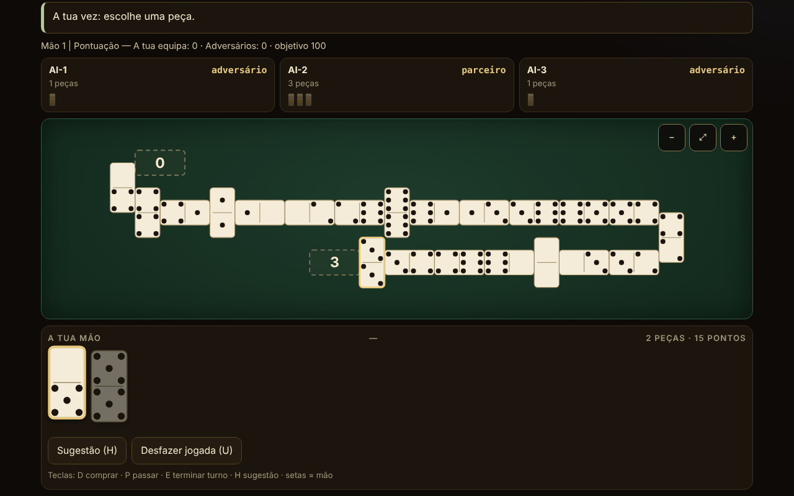

# Domino fără frontiere

[English](README.md) · [Română](README.ro.md) · [Français](README.fr.md) · [Italiano](README.it.md) · [Español](README.es.md) · **Português** · [Deutsch](README.de.md) · [Magyar](README.hu.md)

**Versão:** 1.2.7 · **Última atualização:** 2026-10-23

Idiomas da interface: **Română, English, Français, Italiano, Español, Português (PT), Deutsch, Magyar**

Atlas do dominó e jogo contra uma IA local: 10 variantes jogáveis (2–4 jogadores, equipas 2 contra 2 onde a regra o exige) e 5 fichas apenas documentadas. Um único ficheiro HTML, offline, sem dependências.

**Aplicação online:** https://chiuta.github.io/Domino-fara-frontiere/

## O que é

Um atlas do dominó (origem, regras, aproximações) e, para as variantes implementadas, uma mesa de jogo em que joga você (lugar 0) contra 1–3 jogadores IA. O motor de regras está separado da interface no mesmo ficheiro, para poder ser testado em Node. A interface e os textos do atlas estão disponíveis em 8 idiomas (ver «Idiomas»).

## Funcionalidades

Apenas o que está verificado no código e nos testes:

- 10 variantes jogáveis, um motor parametrizado para os jogos «em linha» (Block, Draw, All Fives, Muggins, Sniff, Fives and Threes, Matador, dominó latino) e um motor separado para o Mexican Train.
- Conjuntos de duplo-6 (28 peças), duplo-9 (55; apenas no Matador) e duplo-12 (91; Mexican Train e Matador). O invariante 28/55/91 é verificado a cada jogada nos testes.
- Peças SVG grandes, com os pontos desenhados; cada peça da mão tem um `aria-label` da forma «5–3». Opção «Algarismos» em vez de pontos.
- Mesa em serpentina: a linha quebra na margem com uma peça colocada na vertical e muda de sentido; zero peças fora do ecrã (verificado em 32.277 instantâneos com larguras de 8 a 26 colunas, sem sobreposições e sem saídas da largura); deslocamento e zoom (−, ajustar, +), também a 390 px.
- Spinner com quatro braços (All Fives, Sniff); comboios pessoais, comboio mexicano, marcadores e duplos abertos (Mexican Train).
- Primeiro jogador: o duplo mais alto das mãos (ou 6-6 no dominó latino); compra do monte onde a regra o permite; bloqueio (ninguém pode jogar mais): ganha quem tiver menos pontos restantes, com a regra de pontuação de cada variante (descrita na ficha da variante).
- IA em três níveis que realmente diferem (ver «Limites»): 1 aleatório/guloso, 2 heurísticas, 3 conta as peças jogadas e deduz dos passes o que um adversário não tem. A IA trabalha apenas sobre a vista pública + a sua própria mão.
- Sugestão (H), modo «mostrar as mãos da IA» explícito e só para aprender, semente opcional para jogos reproduzíveis, estatísticas locais, tema claro/escuro (na primeira abertura segue-se a preferência do sistema), 3 tamanhos de texto, jogo automático da jogada única (comprar/passar).
- «Anular jogada» (botão ou tecla U): volta ao estado anterior à sua última jogada (até 40 passos, incluindo as jogadas da IA feitas entretanto; o estado é clonado, não recalculado). Um jogo em que usou a anulação não entra nas estatísticas.
- Aleatoriedade: `crypto.getRandomValues` com amostragem por rejeição; com semente, mulberry32 (a mesma amostragem). Baralhamento de Fisher–Yates.
- Acessibilidade: jogo completo pelo teclado, `aria-live` no estado, foco visível, alvos táteis ≥ 44 px (medido a 390 px; exceção: os botões do rodapé de donativos, ~29 px), foco do teclado mantido após cada jogada, contraste ≥ 4,5:1 (medido nos pares de cores de ambos os temas), `prefers-reduced-motion`, sem deslocamento horizontal a 390 px, `<noscript>`, `lang` dinâmico.

## Variantes

| Variante | Jogável? | ⚠ Aproximações (em resumo; o texto completo está na ficha da aplicação) |
|---|---|---|
| Block (sem compra) | sim | – |
| Draw (com compra do monte) | sim | Mãos 7/7/6 (2/3/4 jogadores), reserva de 2 peças (Pagat); ⚠ a compra voluntária não é permitida (só se compra quando não se pode jogar) |
| All Fives (com spinner) | sim | ⚠ os braços 3–4 só se abrem depois de o spinner ter ambos os lados cobertos (uso americano); arredondamento a 5 sobre o total, não peça a peça; com 3 jogadores, o empate divide metade arredondada por defeito |
| Muggins (All Fives sem spinner) | sim | ⚠ a fonte é inconsistente; escolheu-se «quem sai arrecada»; sem equipas |
| Sniff | sim | variante americana (Sniff transversal = spinner); as extremidades laterais do spinner contam enquanto estiverem livres (o exemplo 8/14/15 da Pagat verificado); ⚠ arredondamento e bloqueio não especificados pela fonte; sem equipas |
| Fives and Threes | sim | ⚠ sem equipas («chip out» sobre os parceiros); abre com o duplo mais alto em vez de sorteio; IA: os níveis não diferem de forma mensurável |
| Matador (soma 7) | sim | ⚠ os matadores para duplo-9/12 são extrapolados; a fonte descreve apenas 4 jogadores (2–3 é uma extensão); mão de 7 peças também em duplo-9/12; regra de passe escolhida: «compra até poder jogar ou até restarem 2 peças» |
| Dominó latino por equipas 2v2, estilo venezuelano, objetivo 100 | sim | ⚠ a versão mexicana (regras de bloqueio/início diferentes) não está implementada; apenas a variante descrita na Pagat; Cuban/Dominican não são reproduzidas; sem «refazer a mão», sem bónus capicúa/chuchazo/dominao |
| Dominó latino 200 | sim | ⚠ nem FID puro, nem «Doscientos» puro (híbrido); após um bloqueio começa o jogador com menos pontos da equipa vencedora; abre com 6-6 (a FID escolhe por sorteio de peças); sem «Quinientos» nem «Chiva» |
| Mexican Train (duplo-12, comboios pessoais) | sim | ⚠ 2–4 jogadores (a fonte permite 10); 1, 3 ou 13 rondas; o duplo-branco a 50 apenas como opção; IA: os níveis 2 e 3 são igualmente fortes |
| Chicken Foot | só atlas | não implementado (disposição em árvore) |
| Bergen / Double Bergen | só atlas | a pontuação Bergen não está implementada |
| Five Up | só atlas | as regras completas não foram verificadas |
| All Threes | só atlas | não implementado separadamente |
| Variantes latinas regionais (Quinientos, Milo, Sudan) | só atlas | – |

Não estão incluídos os «dominós de cor» (termo ambíguo) e o Sebastopol (a página da fonte não pôde ser consultada; nada se afirma sobre eles).

**A variante latina escolhida.** O dominó latino por equipas joga-se em várias versões regionais. Foi implementada a versão venezuelana/mexicana descrita na Pagat (objetivo 100, no fim o vencedor leva os pontos das peças restantes dos adversários) e a versão de 200 (FID/«Doscientos», somam-se todos os pontos restantes, o vencedor da mão abre a seguinte). Os termos: «pase» = abster-se de jogar; «pase mutual» = tranque, isto é, o bloqueio em que ninguém pode jogar mais (ganha a equipa com menos pontos, o empate não dá pontos); «capot» = vitória com os adversários a zero (definição escolhida aqui, não norma federativa).

## Manual de utilização

1. No **Atlas**, escolha uma variante e prima «Jogar». «Regras» mostra a origem, as regras e as aproximações.
2. Na janela de definições escolha o número de jogadores, as equipas (a 4), o nível da IA, eventualmente uma semente; prima «Jogar».
3. Quando é a sua vez, as peças jogáveis ficam levantadas e realçadas. Prima uma peça; se tiver um único destino é jogada de imediato, caso contrário escolhe o destino com os botões sob a mão ou premindo uma extremidade assinalada na mesa.
4. Se não tiver jogada: «Comprar» (D) ou «Passar» (P). Com «Auto» ativo, a jogada única é feita automaticamente ao fim de um segundo.
5. Mexican Train: a sua primeira vez pode ser uma cadeia de peças no seu comboio, e depois «Terminar a vez» (E). Um duplo exige uma peça a mais; um duplo aberto tem de ser satisfeito. Quando passa, coloca o seu marcador no comboio.
6. Teclado: Tab até à mão, setas entre peças, Enter para jogar; D, P, E, H (sugestão), U (anular jogada). Esc fecha as janelas.
7. Os botões do canto: idioma, tema, tamanho do texto, algarismos, auto, estatísticas, sobre. Zoom na mesa: −, ⤢, +.

## Idiomas

Os elementos da interface (botões, mensagens, registo, resultados) estão em romeno, inglês, francês, italiano, espanhol, português, alemão e húngaro, com seletor e deteção automática. **Os textos longos do atlas (origem, descrição, regras, aproximações das 15 fichas) estão traduzidos para os 8 idiomas, e a pesquisa abrange o nome e a descrição no idioma atual. Permanecem inalterados: a lista de fontes (citações/URL; a segunda linha continua em romeno) e os termos do dominó latino (pase, tranque, capot), mantidos como na fonte. As traduções para francês, italiano, espanhol, português, alemão e húngaro são automáticas, não verificadas por falantes nativos.** A paridade das chaves de tradução é verificada com um script (`tests/i18n-check.js`: 180 chaves × 7 idiomas, sem lacunas, os mesmos marcadores de posição).

## Privacidade e rede

Sem telemetria, sem pedidos de rede, sem `fetch`, sem `eval`. CSP: `default-src 'none'; script-src 'sha256-…'; style-src 'unsafe-inline'; img-src data:; base-uri 'none'; form-action 'none'` (o script está ligado por hash; `style-src 'unsafe-inline'` é necessário para o estilo inline e para o bloco de apoio). As preferências e as estatísticas são guardadas em `localStorage` (chave `domino-fara-frontiere.prefs`), acedido apenas em `try/catch`; sem ele a aplicação funciona (testado com `localStorage` bloqueado). `innerHTML` é usado apenas para SVG gerado a partir de inteiros e de cadeias passadas por `esc()`. As únicas ligações externas são o Buy Me a Coffee no bloco de apoio (`rel="noopener"`), copiado de forma idêntica dos outros repositórios.

## Limites e avisos

- **IA**: não tem acesso às mãos dos outros. Nível 1: aleatório (ou guloso nos pontos nos jogos com pontuação nas extremidades). Nível 2: heurísticas (pontos, flexibilidade, duplos, conservação dos matadores). Nível 3: além disso conta as peças jogadas, deduz dos passes o que um adversário não tem e estima a probabilidade de os adversários passarem. Força medida (300 jogos, lugares alternados): o nível 3 vence o nível 1 em 54–98% dos jogos (consoante a variante) e o nível 2 em 52–76%; o nível 2 vence o nível 1 em 48–98%. **Exceções**: no Fives and Threes os níveis são praticamente iguais (~50%), e no Mexican Train os níveis 2 e 3 são igualmente fortes (44% para o nível 3 contra o 2), ambos vencendo claramente o nível 1 (80–85%). O modo «mostrar as mãos da IA» é explícito e só para aprender; a IA, de qualquer modo, não olha para a sua mão.
- As regras de alguns jogos diferem de região para região; as escolhas feitas estão na coluna ⚠ e nas fichas da aplicação.
- Não é uma ferramenta de apostas e não tem valor oficial para as federações.
- A interface foi verificada visualmente no Chromium (1280×800 e 390×844); não foi testada no Safari, no Firefox nem com leitores de ecrã reais.
- Não foi implementado o modo multijogador em rede (e não será: a aplicação não tem rede).

## Testes

Tudo o que se segue foi executado sobre o `index.html` final (os scripts são mantidos fora do pacote):

- **Jogos IA contra IA**, 500 jogos por configuração, validados passo a passo por um validador de legalidade independente (reimplementado a partir das regras, sem código do motor): Block 2/3/4, Draw 2/3/4, Matador duplo-6/9/12 com 2/3/4, All Fives 2/3/4 + equipas, Muggins 2/3/4, Sniff 2/3/4, Fives and Threes 2/3/4, latino 100 e latino 200; Mexican Train 2/3/4 × 500 jogos × 13 rondas (19.500 rondas). Resultado: **0 falhas** (sem bloqueios do motor, sem jogadas ilegais, invariante 28/55/91 a cada jogada, mãos e monte idênticos ao validador, pontos nas extremidades iguais aos calculados de forma independente, ganho de fim de mão idêntico).
- **Cenários escritos à mão**: 227 verificações, 0 falhas (pontuação All Fives / Muggins / Fives and Threes nas extremidades, incluindo duplo na extremidade, spinner e ausência de spinner; Mexican Train: duplos abertos no comboio próprio, no de outro assinalado/não assinalado e no mexicano, primeira vez, marcadores, bloqueio, duplo-branco a 50, 13 rondas; IA sem acesso às mãos).
- **Disposição da mesa**: 32.277 instantâneos, 12,7 milhões de verificações (sem sobreposições, sem saídas da largura, número correto de peças), larguras de 8 a 26 colunas.
- **UI** (Playwright + Chromium): um jogo completo jogado pela interface em cada variante a 1280 px e 390 px, 0 erros na consola, 0 violações de CSP, 0 pedidos externos, sem deslocamento horizontal; jogo pelo teclado; `localStorage` bloqueado; deteção automática do idioma; alvos táteis ≥ 44 px (exceto o rodapé).

## Fontes

- Pagat.com: Muggins, Block, All Fives, Sniff, Fives and Threes, Matador, Bergen, Latin Partnership Dominoes, Mexican Train, Chicken Foot e as páginas de famílias (fives family, train family, matador matching, Bergen scoring). As regras foram lidas e implementadas a partir do texto; onde a fonte é inconsistente ou omissa, a escolha está assinalada ⚠.
- Para as versões cubana, dominicana e Sebastopol não foi possível consultar nenhuma fonte; não se afirma que estejam reproduzidas.

## Execução local

Abra `index.html` num navegador (não requer servidor). Para reconstruir a partir das fontes de trabalho: `node build.mjs`; para os testes: `node tests/fuzz.js <index.html> 500`, `node tests/scenarios.js <index.html>`, `node tests/layout.js <index.html>`, `node tests/i18n-check.js` (os scripts encontram-se na pasta de trabalho, fora do pacote publicado).

## Histórico / Changelog

### 1.2.7 — 2026-10-23
- As chaves de armazenamento têm agora o prefixo da aplicação (`domino-fara-frontiere.prefs`); os dados existentes (preferências, tema e estatísticas) são migrados automaticamente no arranque e as cópias antigas `.fff.json` continuam a poder ser importadas.
- fff-kit 1.2.0: armazenamento sem prefixo corrigido

### 1.2.5 — 2026-10-22

fff-kit 1.1.4: áreas de toque e texto mínimo.

### 1.2.4 — 2026-10-22

fff-kit 1.1.2: PBKDF2 com 600.000 iterações, proteção anti-clickjacking.

- 1.2.3 — 2026-10-22: melhorias para telemóvel e acessibilidade: texto de pelo menos 12 px e áreas táteis de pelo menos 24 px. foco de teclado visível em todos os controlos.
- 1.2.2 — 2026-10-22: **correção**: a secção de fontes já está traduzida em todos os idiomas.
- 1.2.1 — 2026-10-19: as 15 fichas do atlas (nome, origem, descrição, regras, aproximações; cerca de 21 000 carateres) estão traduzidas para fr, it, es, pt, de, hu; a nota «texto em inglês» já não aparece; a pesquisa abrange o nome e a descrição no idioma atual.
- 1.1.0 — 2026-10-14: Cópia de segurança e etiquetagem de dados (fff-kit).

- 1.0.0 — 2026-10-12: a versão e a data da última atualização são apresentadas na aplicação (primeira versão numerada; na caixa de diálogo «Sobre»).

Ronda 7:
- Um jogo começado (após a primeira jogada) e não terminado pede agora a confirmação do navegador ao recarregar ou fechar a página (`beforeunload`), para não perder o jogo por acidente; após «game over» e antes da primeira jogada não aparece nenhuma pergunta. O jogo não é guardado entre visitas. Hash CSP recalculado; axe-core = 0 violações a 1280 e 360 px.
- A suite `tests/` e `build.mjs` da secção «Execução local» continuam fora do repositório publicado (declarado também aí); verificações: `node --check`, um jogo pela interface, 0 erros de consola/CSP.

Ronda 6:
- Novidade: «Anular jogada» (U) com uma pilha de 40 estados; os jogos com anulação são excluídos das estatísticas. O tema inicial segue `prefers-color-scheme` se não houver outro guardado. O registo do jogo pode ser deslocado pelo teclado (ponto de referência com `tabindex`). Hash CSP recalculado.
- Quando escolheu uma peça que pode ser colocada em duas extremidades, aparece agora uma mensagem visível «Escolha onde a coloca …» acima dos botões de destino (antes existia apenas a mensagem de estado).
- Acessibilidade: os títulos dos cartões do atlas são h2 (ordem correta sob h1), o bloco de apoio é um ponto de referência `complementary`; axe-core = 0 violações a 1280 e 360 px. O hash CSP do script foi recalculado.
- Nota: a suite de testes do README (`tests/`) e `build.mjs` não se encontram neste repositório; após a alteração foram verificados `node --check`, um jogo pela interface e 0 erros de consola/CSP.

## Licença

MIT — ver o ficheiro `LICENSE`.

## Nomes comerciais

«Mexican Train» e outros nomes de produtos podem ser marcas dos seus titulares; a aplicação não é afiliada a estes, e os nomes são usados de forma descritiva para regras tradicionais de dominó.

## Autor

Alexandru-Ionuț Chiuță (Alexio).

## Resumo
Um atlas do dominó num único ficheiro, offline, com dez variantes jogáveis contra uma IA local (Block, Draw, All Fives, Muggins, Sniff, Fives and Threes, Matador em duplo-6/9/12, duas versões latinas por equipas 2v2 e Mexican Train em duplo-12) mais cinco fichas apenas documentadas (Chicken Foot, Bergen, Five Up, All Threes, versões latinas regionais). O motor de regras é puro e está separado da interface, com mesa em serpentina, deslocamento e zoom, jogo completo pelo teclado e interface em 8 idiomas (os textos longos do atlas também estão traduzidos). A IA nunca vê as mãos ocultas (o nível 3 conta as peças e deduz dos passes); os níveis 2 e 3 são igualmente fortes no Mexican Train, e os três são aproximadamente iguais no Fives and Threes. Verificado com 500 jogos IA contra IA validados de forma independente por configuração (0 falhas), 227 cenários de regras escritos à mão (mais 135 da auditoria independente) e fuzzing da disposição. Sem rede, sem telemetria, CSP estrita. Cada aproximação está assinalada na tabela de variantes e nas regras da aplicação. Licença: MIT (ver LICENSE). Fontes das regras: Pagat.com.

## Auditoria independente

Uma auditoria adversarial separada corrigiu: as mãos no Draw, a pontuação do Sniff, o jogador que começa após um bloqueio no latino 200, uma falha com estatísticas corrompidas no localStorage, a perda do foco do teclado, uma alternativa para uma jogada ilegal da IA. Executado sobre a versão final: fuzz independente (linha + comboio), 135 cenários, teste de informação oculta para a IA, 6000 mesas, RNG, i18n, mais os testes do construtor.
