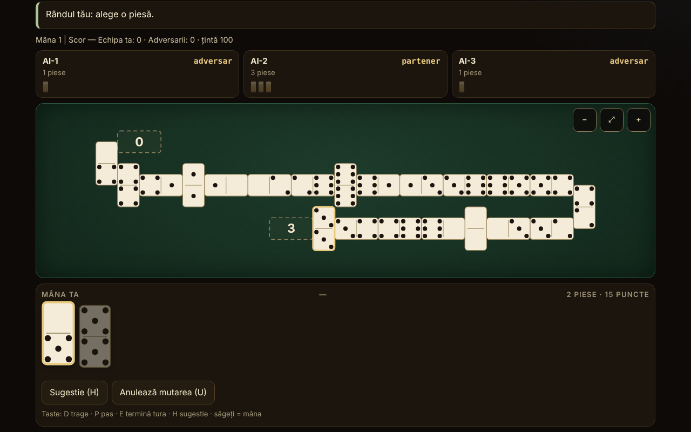

# Domino fără frontiere

[English](README.md) · **Română** · [Français](README.fr.md) · [Italiano](README.it.md) · [Español](README.es.md) · [Português](README.pt.md) · [Deutsch](README.de.md) · [Magyar](README.hu.md)

**Versiune:** 2.0.1 · **Ultima actualizare:** 2026-10-27

**Stare:** stabilă; recenzia din 2026-10-27 aplicată (vezi CHANGELOG.md); modul multiplayer local unificat este **planificat**, neimplementat · **Offline:** complet (fără cereri de rețea)

Limbile interfeței: **Română, English, Français, Italiano, Español, Português (PT), Deutsch, Magyar**

Atlas de domino și joc contra unui AI local: 10 variante jucabile (2–4 jucători, echipe 2 contra 2 unde regula o cere) și 5 fișe doar documentate. Un singur fișier HTML, offline, fără dependențe.

Jucabile (10): Block, Draw, All Fives, Muggins, Sniff, Fives and Threes, Matador, domino latin 2v2 (țintă 100), domino latin 200, Mexican Train. Doar în atlas (5): Chicken Foot, Bergen / Double Bergen, Five Up, All Threes, variante latine regionale (Quinientos, Milo, Sudan).

**Live:** https://chiuta.github.io/Domino-fara-frontiere/

## Ce este

Un atlas al dominoului (origine, reguli, aproximări) și, pentru variantele implementate, o masă de joc la care joci tu (locul 0) contra a 1–3 jucători AI. Motorul de reguli este separat de interfață în același fișier, ca să poată fi testat în Node. Interfața și textele atlasului sunt disponibile în 8 limbi (vezi „Limbi”).

## Funcții

Doar ce este verificat în cod și în teste:

- 10 variante jucabile, un motor parametrizat pentru „linie” (Block, Draw, All Fives, Muggins, Sniff, Fives and Threes, Matador, domino latin) și un motor separat pentru Mexican Train.
- Seturi double-6 (28 de piese), double-9 (55; doar la Matador) și double-12 (91; Mexican Train și Matador). Invariantul 28/55/91 este verificat la fiecare mutare în teste.
- Piese SVG mari, cu punctele desenate; fiecare piesă din mână are `aria-label` de forma „5–3”. Opțiune „Cifre” în loc de puncte.
- Masă în serpentină: linia se rupe la margine cu o piesă pusă pe verticală și își schimbă sensul; zero piese în afara ecranului (verificat pe 32 277 de instantanee la lățimi de 8–26 de coloane, fără suprapuneri și fără ieșiri din lățime); derulare și zoom (−, potrivire, +), inclusiv pe 390 px.
- Spinner cu patru brațe (All Fives, Sniff); trenuri personale, tren mexican, marcaje și dubluri deschise (Mexican Train).
- Primul jucător: cel mai mare dublu din mâini (sau 6-6 la dominoul latin); tragere din boneyard acolo unde regula o permite; blocaj (nimeni nu mai poate juca): câștigă cine are cele mai puține puncte rămase, cu regula de scor a fiecărei variante (descrisă în fișa variantei).
- AI în trei niveluri care diferă real (vezi „Limite”): 1 aleatoriu/lacom, 2 euristici, 3 numără piesele jucate și deduce din pase ce nu are un adversar. AI-ul lucrează numai pe vederea publică + propria mână.
- Sugestie (H), mod „arată mâinile AI” explicit și doar pentru învățat, sămânță opțională pentru partide reproductibile, statistici locale, temă luminoasă/întunecată (la prima deschidere se urmează preferința sistemului), 3 mărimi de text, auto-joc al mutării unice (tragere/pas).
- „Anulează mutarea” (buton sau tasta U): revine la starea de dinaintea ultimei tale mutări (până la 40 de pași, inclusiv mutările AI făcute între timp; starea se clonează, nu se recalculează). O partidă în care ai folosit anularea nu intră în statistici.
- **Turneu între prieteni (v2.0):** butonul „Turneu” creează un turneu de 2–16 jucători (toți cu toți sau eliminare directă, cu liber pentru număr impar), cu variantele Block, Draw și Mexican Train alternate pe runde. Scorurile partidelor jucate la masă se introduc manual (la Mexican Train câștigă scorul mai mic); clasamentul (3/1/0 puncte), progresul și campionul se calculează local, se salvează în `localStorage` și se pot exporta/importa ca text JSON.
- **Sincronizare p2p a turneului:** organizatorul și un prieten se conectează direct (WebRTC, cod copiat sau QR, fără server, doar cu acordul explicit din dialog); tabelul ajunge la oaspete, iar rezultatele introduse de oricare dintre ei ajung la celălalt (organizatorul validează). O singură legătură odată.
- Randomul: `crypto.getRandomValues` cu eșantionare prin respingere; cu sămânță, mulberry32 (aceeași eșantionare). Amestec Fisher–Yates.
- Accesibilitate: joc complet de la tastatură, `aria-live` pe stare, focus vizibil, ținte tactile ≥ 44 px (măsurat pe 390 px; excepție: butoanele din subsolul de donații, ~29 px), focus de tastatură păstrat după fiecare mutare, contrast ≥ 4,5:1 (măsurat pe perechile de culori din ambele teme), `prefers-reduced-motion`, fără scroll orizontal la 390 px, `<noscript>`, `lang` dinamic.

## Variante

| Variantă | Jucabil? | ⚠ Aproximări (pe scurt; textul complet e în fișa din aplicație) |
|---|---|---|
| Block (fără tragere) | da | – |
| Draw (cu tragere din bon) | da | Mâini 7/7/6 (2/3/4 jucători), rezerva de 2 piese (Pagat); ⚠ tragerea voluntară nu e permisă (se trage doar când nu poți juca) |
| All Fives (cu spinner) | da | ⚠ brațele 3–4 se deschid abia după ce spinnerul are ambele laturi acoperite (uz american); rotunjirea la 5 pe total, nu piesă cu piesă; la 3 jucători, egalitatea împarte jumătate rotunjită în jos |
| Muggins (All Fives fără spinner) | da | ⚠ sursa e inconsistentă; s-a ales „cine iese încasează”; fără echipe |
| Sniff | da | varianta americană (Sniff transversal = spinner); capetele laterale ale spinnerului se numără cât sunt libere (exemplul 8/14/15 de pe Pagat verificat); ⚠ rotunjire și blocaj neprecizate de sursă; fără echipe |
| Fives and Threes | da | ⚠ fără echipe („chip out” pe parteneri); deschide cel mai mare dublu în loc de tragere la sorți; AI: nivelurile nu diferă măsurabil |
| Matador (suma 7) | da | ⚠ matadorii pentru double-9/12 sunt extrapolați; sursa descrie doar 4 jucători (2–3 sunt extindere); mâna de 7 piese și la double-9/12; regula de pas aleasă: „tragi până poți juca sau rămân 2 piese” |
| Domino latin pe echipe 2v2, stil venezuelean, țintă 100 | da | ⚠ versiunea mexicană (reguli de blocaj/start diferite) nu e implementată; doar varianta descrisă pe Pagat; Cuban/Dominican nu sunt reproduse; fără „refacerea mâinii”, fără bonusuri capicúa/chuchazo/dominao |
| Domino latin 200 | da | ⚠ nici FID pur, nici „Doscientos” pur (hibrid); după blocaj începe jucătorul cu cele mai puține puncte din echipa câștigătoare; deschide 6-6 (FID alege prin tragere de piese); fără „Quinientos” și „Chiva” |
| Mexican Train (double-12, trenuri personale) | da | ⚠ 2–4 jucători (sursa permite 10); 1, 3 sau 13 runde; dublul-alb la 50 doar ca opțiune; AI: nivelurile 2 și 3 sunt la fel de puternice |
| Chicken Foot | doar în atlas | nu este implementat (aranjament în arbore) |
| Bergen / Double Bergen | doar în atlas | scorarea Bergen nu este implementată |
| Five Up | doar în atlas | regulile complete nu au fost verificate |
| All Threes | doar în atlas | nu este implementat separat |
| Variante latine regionale (Quinientos, Milo, Sudan) | doar în atlas | – |

Nu sunt incluse „domino de culoare” (termen ambiguu) și Sebastopol (pagina sursă nu a putut fi consultată; nu se pretinde nimic despre ele).

**Varianta latină aleasă.** Dominoul latin pe echipe se joacă în mai multe versiuni regionale. S-a implementat versiunea venezueleană/mexicană descrisă pe Pagat (țintă 100, la sfârșit câștigătorul ia punctele pieselor rămase ale adversarilor) și versiunea de 200 (FID/„Doscientos”, se adună toate punctele rămase, câștigătorul mâinii deschide următoarea). Termenii: „pase” = abținerea de la mutare; „pase mutuală” = tranque, adică blocajul în care nimeni nu mai poate juca (câștigă echipa cu mai puține puncte, egalitatea nu dă puncte); „capot” = victorie cu adversarii la zero (definiție aleasă aici, nu normă federală).

## Manual de utilizare

1. În **Atlas**, alege o variantă și apasă „Joacă”. „Reguli” arată originea, regulile și aproximările.
2. În fereastra de setări alege numărul de jucători, echipele (la 4), nivelul AI, eventual o sămânță; apasă „Joacă”.
3. Când e rândul tău, piesele jucabile sunt ridicate și evidențiate. Apasă o piesă; dacă are o singură destinație se joacă imediat, altfel alegi destinația cu butoanele de sub mână sau apăsând un capăt marcat pe masă.
4. Dacă nu ai mutare: „Trage” (D) sau „Pas” (P). Cu „Auto” activ, mutarea unică se face automat după o secundă.
5. Mexican Train: prima ta tură poate fi un lanț de piese pe trenul tău, apoi „Termină tura” (E). Un dublu cere o piesă în plus; un dublu deschis trebuie satisfăcut. Când pasezi, îți pui marcajul pe tren.
6. Tastatură: Tab până la mână, săgeți între piese, Enter pentru a juca; D, P, E, H (sugestie), U (anulează mutarea). Esc închide ferestrele.
7. Butoanele din colț: limba, temă, mărime text, cifre, auto, statistici, despre. Zoom pe masă: −, ⤢, +.

## Limbi

Elementele de interfață (butoane, mesaje, jurnal, rezultate) sunt în română, engleză, franceză, italiană, spaniolă, portugheză, germană și maghiară, cu comutator și autodetecție. **Textele lungi ale atlasului (origine, descriere, reguli, aproximări ale tuturor celor 15 fișe) sunt traduse în toate cele 8 limbi, iar căutarea cuprinde numele și descrierea în limba curentă. Rămân neschimbate: lista de surse (citări/URL-uri; a doua linie rămâne în română) și termenii dominoului latin (pase, tranque, capot), păstrați ca în sursă. Traducerile în franceză, italiană, spaniolă, portugheză, germană și maghiară sunt automate, neverificate de vorbitori nativi.** Paritatea cheilor de traducere este verificată cu un script (`tests/i18n-check.js`: 180 de chei × 7 limbi, fără goluri, aceleași substituenți).

## Confidențialitate și rețea

Fără telemetrie, fără cereri de rețea, fără `fetch`, fără `eval`. CSP: `default-src 'none'; script-src 'sha256-…'; style-src 'unsafe-inline'; img-src data:; base-uri 'none'; form-action 'none'` (scriptul este legat prin hash; `style-src 'unsafe-inline'` este necesar pentru stilul inline și pentru blocul de sprijin). Preferințele și statisticile se păstrează în `localStorage` (cheile `domino-fara-frontiere.prefs` și `domino-fara-frontiere.tourn` pentru turneu), accesat doar în `try/catch`; fără el aplicația funcționează (testat cu `localStorage` blocat). `innerHTML` se folosește doar pentru SVG generat din numere întregi și șiruri trecute prin `esc()`. Singura funcție de rețea este sincronizarea p2p a turneului (WebRTC, doar la cererea explicită, cu acord în dialog; fără server de semnalizare, fără STUN implicit; celălalt jucător vede adresa ta IP). Singurele linkuri externe sunt Buy Me a Coffee din blocul de sprijin (`rel="noopener"`), copiat identic din celelalte repo-uri.

## Limite și avertismente

- **AI**: nu are acces la mâinile altora. Nivelul 1: aleatoriu (sau lacom pe puncte la jocurile cu scor la capete). Nivelul 2: euristici (puncte, flexibilitate, dubluri, păstrarea matadorilor). Nivelul 3: în plus numără piesele jucate, deduce din pase ce nu are un adversar și estimează probabilitatea ca adversarii să paseze. Forța măsurată (300 de partide, locuri alternate): nivelul 3 bate nivelul 1 în 54–98% din partide (în funcție de variantă) și nivelul 2 în 52–76%; nivelul 2 bate nivelul 1 în 48–98%. **Excepții**: la Fives and Threes nivelurile sunt practic egale (~50%), iar la Mexican Train nivelurile 2 și 3 sunt la fel de puternice (44% pentru nivelul 3 în fața lui 2), amândouă bat clar nivelul 1 (80–85%). Modul „arată mâinile AI” este explicit și doar pentru învățat; AI-ul nu se uită oricum la mâna ta.
- Regulile unor jocuri diferă de la regiune la regiune; alegerile făcute sunt în coloana ⚠ și în fișele din aplicație.
- Nu este un instrument de pariuri și nu are valoare oficială pentru federații.
- Interfața a fost verificată vizual în Chromium (1280×800 și 390×844); nu a fost testată pe Safari, Firefox sau cu cititoare de ecran reale.
- Partidele de domino se joacă tot contra AI-ului local; turneul doar ține evidența partidelor jucate la masă (nu joacă partida în rețea). Sincronizarea p2p a turneului nu merge peste NAT simetric fără STUN/TURN (limita este descrisă în dialogul kitului).

## Teste

Tot ce urmează s-a rulat pe `index.html` final (scripturile sunt păstrate în afara pachetului):

- **Partide AI contra AI**, 500 de partide pe configurație, validate pas cu pas de un validator independent de legalitate (reimplementat din reguli, fără cod din motor): Block 2/3/4, Draw 2/3/4, Matador double-6/9/12 la 2/3/4, All Fives 2/3/4 + echipe, Muggins 2/3/4, Sniff 2/3/4, Fives and Threes 2/3/4, latin 100 și latin 200; Mexican Train 2/3/4 × 500 de partide × 13 runde (19 500 de runde). Rezultat: **0 eșecuri** (fără blocaje de motor, fără mutări ilegale, invariant 28/55/91 la fiecare mutare, mâini și boneyard identice cu validatorul, punctele la capete egale cu cele calculate independent, câștigul de sfârșit de mână identic).
- **Scenarii scrise de mână**: 227 de verificări, 0 eșecuri (scorare All Fives / Muggins / Fives and Threes pe capete, inclusiv dublu la capăt, spinner și lipsa spinnerului; Mexican Train: dubluri deschise pe trenul propriu, pe al altuia marcat/nemarcat și pe cel mexican, prima tură, marcaje, blocaj, dublul-alb la 50, 13 runde; AI fără acces la mâini).
- **Aranjarea mesei**: 32 277 de instantanee, 12,7 milioane de verificări (fără suprapuneri, fără ieșiri din lățime, număr corect de piese), lățimi de la 8 la 26 de coloane.
- **UI** (Playwright + Chromium): câte o partidă completă jucată prin interfață la fiecare variantă la 1280 px și 390 px, 0 erori în consolă, 0 încălcări CSP, 0 cereri externe, fără scroll orizontal; joc de la tastatură; `localStorage` blocat; autodetecție de limbă; ținte tactile ≥ 44 px (cu excepția subsolului).

## Surse

- Pagat.com: Muggins, Block, All Fives, Sniff, Fives and Threes, Matador, Bergen, Latin Partnership Dominoes, Mexican Train, Chicken Foot și paginile de familie (fives family, train family, matador matching, Bergen scoring). Regulile s-au citit și s-au implementat din text; unde sursa e inconsistentă sau tace, alegerea e marcată ⚠.
- Pentru versiunile cubaneză, dominicană și Sebastopol nu s-a putut consulta o sursă; nu se pretinde că sunt reproduse.

## Rulare locală

Deschide `index.html` într-un browser (nu cere server). Pentru a reconstrui din sursele de lucru: `node build.mjs`; pentru teste: `node tests/fuzz.js <index.html> 500`, `node tests/scenarios.js <index.html>`, `node tests/layout.js <index.html>`, `node tests/i18n-check.js` (scripturile se află în directorul de lucru, în afara pachetului publicat).

## Istoric / Changelog

### 1.2.7 — 2026-10-23
- Cheile de stocare au acum prefixul aplicației (`domino-fara-frontiere.prefs`); datele existente (preferințele, tema și statisticile) se migrează automat la pornire, iar copiile vechi `.fff.json` se pot importa în continuare.
- fff-kit 1.2.0: stocare fără prefix remediată

### 1.2.5 — 2026-10-22

fff-kit 1.1.4: ținte tactile și text minim.

### 1.2.4 — 2026-10-22

fff-kit 1.1.2: PBKDF2 600 000 iterații, protecție anti-clickjacking.

- 1.2.3 — 2026-10-22: finisaje pentru mobil și accesibilitate: text de cel puțin 12 px și ținte tactile de cel puțin 24 px. focus de tastatură vizibil pe orice control.
- 1.2.2 — 2026-10-22: **remediere**: secțiunea de surse este acum tradusă în toate limbile.
- 1.2.1 — 2026-10-19: toate cele 15 fișe de atlas (nume, origine, descriere, reguli, aproximări; circa 21.000 de caractere) sunt traduse în fr, it, es, pt, de, hu; nota „text în engleză” nu mai apare; căutarea cuprinde numele și descrierea în limba curentă.
- 1.1.0 — 2026-10-14: Copie de rezervă și etichetare date (fff-kit).

- 1.0.0 — 2026-10-12: versiunea și data ultimei actualizări sunt afișate în aplicație (prima versiune numerotată; în dialogul „Despre”).

Runda 7:
- O partidă începută (după prima mutare) și nefinalizată cere acum confirmarea browserului la reîncărcarea sau închiderea paginii (`beforeunload`), ca să nu pierzi accidental partida; după „game over” și înainte de prima mutare nu apare nicio întrebare. Partida nu este salvată între vizite. Hash-ul CSP recalculat; axe-core = 0 violări la 1280 și 360 px.
- Suita `tests/` și `build.mjs` din secțiunea „Rulare locală” rămân în afara depozitului publicat (declarat și acolo); verificări: `node --check`, o partidă prin interfață, 0 erori de consolă/CSP.

Runda 6:
- Nou: „Anulează mutarea” (U) cu stivă de 40 de stări; partidele cu anulare sunt excluse din statistici. Tema inițială urmează `prefers-color-scheme` dacă nu e salvată alta. Jurnalul de partidă poate fi derulat de la tastatură (reper cu `tabindex`). Hash-ul CSP recalculat.
- Când ai ales o piesă care se poate pune la două capete, apare acum un mesaj vizibil „Alege unde pui …” deasupra butoanelor de destinație (înainte exista doar mesajul de stare).
- Accesibilitate: titlurile cardurilor din atlas sunt h2 (ordine corectă sub h1), blocul de sprijin este reper `complementary`; axe-core = 0 violări la 1280 și 360 px. Hash-ul CSP al scriptului a fost recalculat.
- Notă: suita de teste din README (`tests/`) și `build.mjs` nu se află în acest depozit; după modificare s-au verificat `node --check`, o partidă prin interfață și 0 erori de consolă/CSP.

## Licență

MIT — vezi fișierul `LICENSE`.

## Nume comerciale

„Mexican Train” și alte denumiri de produs pot fi mărci ale deținătorilor lor; aplicația nu este afiliată cu ei, iar denumirile sunt folosite descriptiv pentru reguli tradiționale de domino.

## Autor

Alexandru-Ionuț Chiuță (Alexio).

## Rezumat

Un atlas de domino offline într-un singur fișier, cu zece variante jucabile împotriva unui AI local (Block, Draw, All Fives, Muggins, Sniff, Fives and Threes, Matador pe dublu-6/9/12, două versiuni latine 2 contra 2 în parteneriat și Mexican Train pe dublu-12), plus cinci intrări doar documentate (Chicken Foot, Bergen, Five Up, All Threes, versiuni latine regionale). Motorul de reguli este pur și separat de interfață, cu tablă în serpentină, derulare și zoom, joc complet cu tastatura și interfață în 8 limbi (și textele lungi din atlas sunt traduse). AI-ul nu vede niciodată mâinile ascunse (nivelul 3 numără piesele și deduce din pase); nivelurile 2 și 3 sunt la fel de puternice la Mexican Train, iar toate trei sunt aproximativ egale la Fives and Threes. Verificat cu 500 de partide AI contra AI validate independent pentru fiecare configurație (0 eșecuri), 227 de scenarii de reguli scrise de mână (plus 135 din auditul independent) și teste fuzz ale aspectului. Fără rețea, fără telemetrie, CSP strict. Fiecare aproximare este marcată în tabelul variantelor și în regulile din aplicație. Licență: MIT (vezi LICENSE). Surse ale regulilor: Pagat.com.

## Audit independent

Un audit adversarial separat a corectat: mâinile la Draw, scorarea Sniff, începătorul după blocaj la Latin 200, un crash la statistici corupte din localStorage, pierderea focusului de la tastatură, un fallback pentru mutare ilegală a AI-ului. Rulat pe versiunea finală: fuzz independent (line + train), 135 scenarii, test de informație ascunsă pentru AI, 6000 de table, RNG, i18n, plus testele constructorului.
